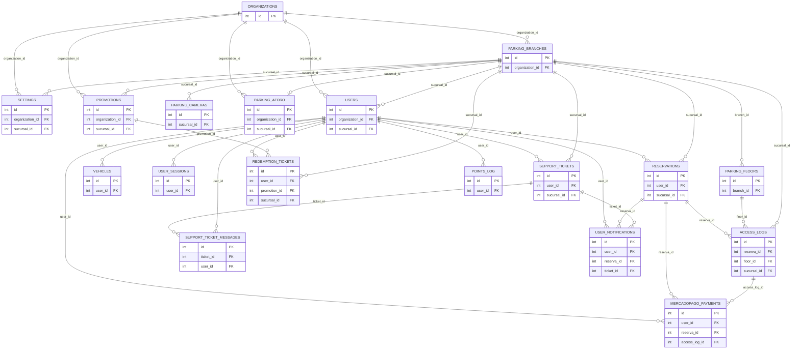

# Modelo de Datos — AUTOPASS

- **Última actualización:** 2026-11-05
- **Fuente de verdad:** `Base.metadata` de SQLAlchemy (modelos en `models/`)
- **Base activa de desarrollo:** `data/local_dev.db` (`DATABASE_URL=sqlite:///./data/local_dev.db`)
- **Base de producción del curso:** PostgreSQL (Neon) mediante `DATABASE_URL`

> Documento generado a partir de los modelos ORM. Si se agrega o modifica una tabla, actualizar `models/` y volver a generar este documento y el HTML `Info proyecto/base_datos.html`.

## 1. Resumen

- **Tablas físicas:** 19 = **18 tablas de negocio** + `alembic_version`.
- **ORM:** SQLAlchemy 2.0 con `declarative_base()` y mapeo clásico por clases.
- **Motor dual:** SQLite para desarrollo/pruebas y PostgreSQL para producción.
- **Multitenancy:** `organizations` es la raíz; las tablas operativas referencian `organization_id` y/o `sucursal_id`.
- **Fechas:** se persisten como texto ISO 8601 mediante `DateTimeAsStr` para compatibilidad SQLite/PostgreSQL.
- **Borrado lógico:** `users.is_deleted`; el resto de entidades usa estado o baja física controlada por servicio.

### Módulos y cantidad de tablas

| Módulo | Tablas |
|---|---:|
| Organización | 3 |
| Configuración | 1 |
| Seguridad | 3 |
| Visión ALPR | 1 |
| Operación | 2 |
| Reservas | 1 |
| Pagos | 1 |
| Puntos | 3 |
| Soporte | 2 |
| Notificaciones | 1 |
| Sistema | 1 |

## 2. Diagrama entidad-relación

El siguiente ERD muestra las claves primarias y foráneas. Las columnas completas están en el diccionario de la sección 4.



## 3. Implementación SQLAlchemy

### 3.1 Base, engine y sesión

```python
from sqlalchemy import create_engine
from sqlalchemy.orm import declarative_base, sessionmaker

SQLALCHEMY_DATABASE_URL = normalize_database_url(settings.DATABASE_URL)
IS_SQLITE = SQLALCHEMY_DATABASE_URL.startswith("sqlite")

engine_args = {"check_same_thread": False} if IS_SQLITE else {}
pool_args = {
    "pool_size": 20,
    "max_overflow": 40,
    "pool_timeout": 60,
    "pool_pre_ping": True,
    "pool_recycle": 1800,
} if not IS_SQLITE else {}

engine = create_engine(SQLALCHEMY_DATABASE_URL, connect_args=engine_args, **pool_args)
SessionLocal = sessionmaker(autocommit=False, autoflush=False, bind=engine)
Base = declarative_base()

def get_db():
    db = SessionLocal()
    try:
        yield db
    except Exception:
        db.rollback()
        raise
    finally:
        db.close()
```

`init_db()` ejecuta `Base.metadata.create_all(bind=engine)` y `sync_schema()` combina esa creación con Alembic al `head`.

### 3.2 Mapeo clase → tabla → archivo

| Tabla | Clase SQLAlchemy | Archivo |
|---|---|---|
| `organizations` | `Organization` | `models/organization.py` |
| `parking_branches` | `ParkingBranch` | `models/parking.py` |
| `parking_floors` | `ParkingFloor` | `models/parking.py` |
| `settings` | `Settings` | `models/parking.py` |
| `users` | `User` | `models/user.py` |
| `vehicles` | `Vehicle` | `models/user.py` |
| `user_sessions` | `UserSession` | `models/user_session.py` |
| `parking_cameras` | `ParkingCamera` | `models/parking.py` |
| `access_logs` | `AccessLog` | `models/parking.py` |
| `parking_aforo` | `ParkingAforo` | `models/parking.py` |
| `reservations` | `Reservation` | `models/reservation.py` |
| `mercadopago_payments` | `MercadoPagoPayment` | `models/mercadopago.py` |
| `promotions` | `Promotion` | `models/user.py` |
| `redemption_tickets` | `RedemptionTicket` | `models/user.py` |
| `points_log` | `PointsLog` | `models/user.py` |
| `support_tickets` | `SupportTicket` | `models/support.py` |
| `support_ticket_messages` | `SupportTicketMessage` | `models/support.py` |
| `user_notifications` | `UserNotification` | `models/notification.py` |
| `alembic_version` | `— (tabla técnica)` | `alembic/env.py` |

### 3.3 Ejemplo de entidad raíz: `Organization`

```python
class Organization(Base):
    """ORGANIZACION (EMPRESA) PROPIETARIA DE SUCURSALES Y USUARIOS.

    Cada Admin General administra UNA organizacion de forma aislada: ve solo sus
    sucursales, su personal y sus clientes. La organizacion marcada como
    `es_principal` es la unica que se muestra en el sitio publico (landing) y a
    la que pertenecen los registros de clientes hechos desde la web.
    """
    __tablename__ = "organizations"
    id = Column(Integer, primary_key=True)
    nombre = Column(String, unique=True, index=True)
    es_principal = Column(Boolean, default=False)
    activa = Column(Boolean, default=True)
    created_at = Column(String, default=_now_iso)
```

### 3.4 Ejemplo de entidad con relaciones y reglas: `User`

```python
class User(Base):
    """MODELO PARA LA GESTION DE USUARIOS Y ADMINISTRADORES."""
    __tablename__ = "users"
    __table_args__ = (
        CheckConstraint("COALESCE(saldo, 0) >= 0", name="ck_users_saldo_nonneg"),
        CheckConstraint("COALESCE(puntos_acumulados, 0) >= 0", name="ck_users_puntos_nonneg"),
    )
    id = Column(Integer, primary_key=True)
    nombre = Column(String)
    apellido = Column(String)
    dni = Column(String, unique=True, index=True)
    telefono = Column(String)
    email = Column(String, unique=True, index=True)
    patente = Column(String, nullable=True) # REFERENCIA RAPIDA DE PATENTE PRINCIPAL
    direccion = Column(String, nullable=True)
    password_hash = Column(String)
    rol = Column(String, default="user") #'ADMIN', 'LOCAL_ADMIN', 'STAFF', 'USER'
    organization_id = Column(Integer, ForeignKey("organizations.id", name="fk_users_organization_id_org",
                                                  onupdate="CASCADE"), nullable=True, index=True)
    sucursal_id = Column(Integer, ForeignKey("parking_branches.id", name="fk_users_sucursal_id_branch",
                                             onupdate="CASCADE"), nullable=True, index=True)
    puntos_acumulados = Column(Integer, default=0)
    saldo = Column(Float, default=0.0)
    is_blocked = Column(Boolean, default=False)
    is_deleted = Column(Boolean, default=False)

    # RELACIONES
    branch = relationship("ParkingBranch", lazy="joined")
    organization = relationship("Organization")
    sucursal = branch_ref_property()
    vehicles = relationship("Vehicle", back_populates="owner")
    reservations = relationship("Reservation", back_populates="user")
    points_logs = relationship("PointsLog", back_populates="user")
    redemption_tickets = relationship("RedemptionTicket", back_populates="user")
```

### 3.5 Ejemplo de entidad transaccional: `Reservation`

```python
class Reservation(Base):
    """REGISTRO DE ESTADIAS PROGRAMADAS O RECURRENTES."""
    __tablename__ = "reservations"
    __table_args__ = (
        CheckConstraint("COALESCE(monto_total, 0) >= 0", name="ck_reservations_monto_total_nonneg"),
        CheckConstraint("COALESCE(monto_reembolsado, 0) >= 0", name="ck_reservations_monto_reembolsado_nonneg"),
        CheckConstraint("fecha_inicio IS NULL OR fecha_fin IS NULL OR fecha_fin >= fecha_inicio",
                        name="ck_reservations_orden_fechas"),
    )
    id = Column(Integer, primary_key=True)
    user_id = Column(Integer, ForeignKey("users.id"), index=True)
    patente = Column(String, index=True)
    fecha_inicio = Column(DateTimeAsStr)
    fecha_fin = Column(DateTimeAsStr)
    dias_semana = Column(String, nullable=True) # ALMACENAMIENTO SERIALIZADO: "0,1,2" (0=LUNES...)
    monto_total = Column(Float)
    monto_reembolsado = Column(Float, default=0.0)
    fecha_pago = Column(DateTimeAsStr, nullable=True) # FECHA DE LA TRANSACCION (PAGO O REEMBOLSO)
    mp_preference_id = Column(String, nullable=True) # ID DE INTEGRACION CON MERCADO PAGO
    estado_pago = Column(String, default="Pendiente")
    estado_reserva = Column(String, default="Pendiente")
    sucursal_id = Column(Integer, ForeignKey("parking_branches.id", name="fk_reservations_sucursal_id_branch",
                                             onupdate="CASCADE"), nullable=True, index=True)
    sucursal_info = Column(String, nullable=True)
    tipo_estadia = Column(String, default="hora")
    cliente_nombre = Column(String, nullable=True)
    recordatorio_confirmado = Column(Boolean, default=False)
    metodo_pago = Column(String, nullable=True)  # METODO DE PAGO UTILIZADO (EFECTIVO, TRANSFERENCIA, TARJETA, MP, ETC)
    tipo_vehiculo = Column(String, default="Auto")  # AUTO / MOTO / CAMIONETA
    origen = Column(String, default="cliente")  # 'cliente' (creada por el usuario) o 'manual' (creada por admin/empleado)
    # FOTO DE TARIFAS AL COTIZAR/CREAR LA RESERVA (auditoría de precios históricos)
    tarifa_hora = Column(Float, nullable=True)       # TARIFA POR HORA VIGENTE EN LA SEDE AL RESERVAR
    tarifa_fraccion = Column(Float, nullable=True)   # TARIFA DE 30 MIN VIGENTE EN LA SEDE AL RESERVAR
    tarifa_aplicada = Column(Float, nullable=True)   # TARIFA UNITARIA DE LA MODALIDAD (hora/día/semana/quincena/mes)
    horas_calculadas = Column(Float, nullable=True)  # DURACIÓN COTIZADA (EN HORAS)
    monto_calculado = Column(Float, nullable=True)   # TOTAL BASE COTIZADO, ANTES DE DESCUENTOS
    descuento_pct = Column(Float, nullable=True)     # % DE DESCUENTO POR CANJE APLICADO AL PAGAR
    tarifa_fijada_en = Column(DateTimeAsStr, nullable=True)  # MOMENTO EN QUE SE FIJÓ ESTA FOTO DE TARIFA

    user = relationship("User", back_populates="reservations")
    access_logs = relationship("AccessLog", back_populates="reservation")
    branch = relationship("ParkingBranch", lazy="joined")
    sucursal_nombre = branch_ref_property()
```

## 4. Diccionario de tablas

### 4.1 Tablas de negocio

### `organizations` — `Organization`

- **Módulo:** Organización
- **Archivo:** `models/organization.py`
- **Propósito:** Empresa propietaria del sistema. Es la raíz del aislamiento multitenant: agrupa sucursales, usuarios, aforos, promociones y configuraciones.

| Columna | Tipo SQLAlchemy | Nulo | Clave | Default | Descripción |
|---|---|---|---|---|---|
| `id` | `INTEGER` | No | PK | — | Identificador único. clave primaria, NOT NULL. |
| `nombre` | `VARCHAR` | Sí | UQ | — | Nombre. único, nullable. |
| `es_principal` | `BOOLEAN` | Sí | — | `False` | Indica si es el registro principal. nullable, default `False`. |
| `activa` | `BOOLEAN` | Sí | — | `True` | Indica si la entidad está activa. nullable, default `True`. |
| `created_at` | `VARCHAR` | Sí | — | función `_now_iso` | Fecha de creación (ISO 8601). nullable, default función `_now_iso`. |

**Restricciones e índices:**
- UNIQUE INDEX `ix_organizations_nombre`: (nombre)

### `parking_branches` — `ParkingBranch`

- **Módulo:** Organización
- **Archivo:** `models/parking.py`
- **Propósito:** Sucursal física de una organización, con dirección, horarios, coordenadas y estado operativo.

| Columna | Tipo SQLAlchemy | Nulo | Clave | Default | Descripción |
|---|---|---|---|---|---|
| `id` | `INTEGER` | No | PK | — | Identificador único. clave primaria, NOT NULL. |
| `nombre` | `VARCHAR` | Sí | IDX | — | Nombre. indexado, nullable. |
| `organization_id` | `INTEGER` | Sí | FK, IDX | — | Organización a la que pertenece (FK). FK → `organizations.id`, indexado, nullable. |
| `direccion` | `VARCHAR` | Sí | — | — | Dirección. nullable. |
| `telefono` | `VARCHAR` | Sí | — | — | Teléfono de contacto. nullable. |
| `horario` | `VARCHAR` | Sí | — | — | Horario de atención. nullable. |
| `is_24h` | `BOOLEAN` | Sí | — | `False` | Is 24h. nullable, default `False`. |
| `logo_url` | `VARCHAR` | Sí | — | — | URL del logo de la organización. nullable. |
| `activa` | `BOOLEAN` | Sí | — | `True` | Indica si la entidad está activa. nullable, default `True`. |
| `latitude` | `FLOAT` | Sí | — | — | Latitud geográfica. nullable. |
| `longitude` | `FLOAT` | Sí | — | — | Longitud geográfica. nullable. |

**Relaciones ORM:** `floors` → `ParkingFloor` (ONETOMANY, back_populates=`branch`).

**Restricciones e índices:**
- UNIQUE INDEX `uq_parking_branches_nombre_org`: (nombre, COALESCE(organization_id, -1))
- INDEX `ix_parking_branches_organization_id`: (organization_id)
- INDEX `ix_parking_branches_nombre`: (nombre)

### `parking_floors` — `ParkingFloor`

- **Módulo:** Organización
- **Archivo:** `models/parking.py`
- **Propósito:** Piso o sector interno de una sucursal, con capacidad y ocupación física y de reservas por tipo de vehículo.

| Columna | Tipo SQLAlchemy | Nulo | Clave | Default | Descripción |
|---|---|---|---|---|---|
| `id` | `INTEGER` | No | PK | — | Identificador único. clave primaria, NOT NULL. |
| `branch_id` | `INTEGER` | Sí | FK | — | Sucursal asociada (FK). FK → `parking_branches.id`, nullable. |
| `nombre` | `VARCHAR` | Sí | — | — | Nombre. nullable. |
| `capacidad_total` | `INTEGER` | Sí | — | `20` | Capacidad total del piso. nullable, default `20`. |
| `ocupacion_actual` | `INTEGER` | Sí | — | `0` | Ocupacion actual. nullable, default `0`. |
| `capacidad_motos` | `INTEGER` | Sí | — | `10` | Capacidad para motos. nullable, default `10`. |
| `ocupacion_motos` | `INTEGER` | Sí | — | `0` | Motos ocupadas. nullable, default `0`. |
| `capacidad_camionetas` | `INTEGER` | Sí | — | `5` | Capacidad para camionetas. nullable, default `5`. |
| `ocupacion_camionetas` | `INTEGER` | Sí | — | `0` | Camionetas ocupadas. nullable, default `0`. |
| `capacidad_reservas_autos` | `INTEGER` | Sí | — | `5` | Capacidad reservas autos. nullable, default `5`. |
| `ocupacion_reservas_autos` | `INTEGER` | Sí | — | `0` | Ocupacion reservas autos. nullable, default `0`. |
| `capacidad_reservas_motos` | `INTEGER` | Sí | — | `3` | Capacidad reservas motos. nullable, default `3`. |
| `ocupacion_reservas_motos` | `INTEGER` | Sí | — | `0` | Ocupacion reservas motos. nullable, default `0`. |
| `capacidad_reservas_camionetas` | `INTEGER` | Sí | — | `2` | Capacidad reservas camionetas. nullable, default `2`. |
| `ocupacion_reservas_camionetas` | `INTEGER` | Sí | — | `0` | Ocupacion reservas camionetas. nullable, default `0`. |
| `capacidad_reservas` | `INTEGER` | Sí | — | `10` | Capacidad reservas. nullable, default `10`. |
| `ocupacion_reservas` | `INTEGER` | Sí | — | `0` | Plazas ocupadas por reservas. nullable, default `0`. |

**Relaciones ORM:** `branch` → `ParkingBranch` (MANYTOONE, back_populates=`floors`).

### `settings` — `Settings`

- **Módulo:** Configuración
- **Archivo:** `models/parking.py`
- **Propósito:** Parámetros de configuración por organización y sucursal: tarifas, tolerancias y valores de texto.

| Columna | Tipo SQLAlchemy | Nulo | Clave | Default | Descripción |
|---|---|---|---|---|---|
| `id` | `INTEGER` | No | PK | — | Identificador único. clave primaria, NOT NULL. |
| `clave` | `VARCHAR` | Sí | — | — | Clave de configuración. nullable. |
| `valor` | `FLOAT` | Sí | — | — | Valor numérico. nullable. |
| `valor_str` | `VARCHAR` | Sí | — | — | Valor textual. nullable. |
| `organization_id` | `INTEGER` | Sí | FK, IDX | — | Organización a la que pertenece (FK). FK → `organizations.id`, indexado, nullable. |
| `sucursal_id` | `INTEGER` | Sí | FK, IDX | — | Sucursal a la que pertenece (FK). FK → `parking_branches.id`, indexado, nullable. |

**Relaciones ORM:** `branch` → `ParkingBranch` (MANYTOONE).

**Restricciones e índices:**
- CHECK `ck_settings_valor_nonneg`: `COALESCE(valor, 0) >= 0`
- UNIQUE INDEX `uq_settings_clave_sucursal_org`: (clave, COALESCE(sucursal_id, -1), COALESCE(organization_id, -1))
- INDEX `ix_settings_sucursal_id`: (sucursal_id)
- INDEX `ix_settings_organization_id`: (organization_id)

### `users` — `User`

- **Módulo:** Seguridad
- **Archivo:** `models/user.py`
- **Propósito:** Cuenta de usuario con credenciales, rol, organización, sucursal, saldo y puntos.

| Columna | Tipo SQLAlchemy | Nulo | Clave | Default | Descripción |
|---|---|---|---|---|---|
| `id` | `INTEGER` | No | PK | — | Identificador único. clave primaria, NOT NULL. |
| `nombre` | `VARCHAR` | Sí | — | — | Nombre. nullable. |
| `apellido` | `VARCHAR` | Sí | — | — | Apellido. nullable. |
| `dni` | `VARCHAR` | Sí | UQ | — | Documento Nacional de Identidad. único, nullable. |
| `telefono` | `VARCHAR` | Sí | — | — | Teléfono de contacto. nullable. |
| `email` | `VARCHAR` | Sí | UQ | — | Correo electrónico de login. único, nullable. |
| `patente` | `VARCHAR` | Sí | — | — | Patente del vehículo. nullable. |
| `direccion` | `VARCHAR` | Sí | — | — | Dirección. nullable. |
| `password_hash` | `VARCHAR` | Sí | — | — | Hash bcrypt de la contraseña. nullable. |
| `rol` | `VARCHAR` | Sí | — | `user` | Rol del usuario: admin, local_admin, staff o user. nullable, default `user`. |
| `organization_id` | `INTEGER` | Sí | FK, IDX | — | Organización a la que pertenece (FK). FK → `organizations.id`, indexado, nullable. |
| `sucursal_id` | `INTEGER` | Sí | FK, IDX | — | Sucursal a la que pertenece (FK). FK → `parking_branches.id`, indexado, nullable. |
| `puntos_acumulados` | `INTEGER` | Sí | — | `0` | Puntos acumulados del usuario. nullable, default `0`. |
| `saldo` | `FLOAT` | Sí | — | `0.0` | Saldo monetario disponible. nullable, default `0.0`. |
| `is_blocked` | `BOOLEAN` | Sí | — | `False` | Indica si el usuario está bloqueado. nullable, default `False`. |
| `is_deleted` | `BOOLEAN` | Sí | — | `False` | Indica borrado lógico. nullable, default `False`. |

**Relaciones ORM:** `branch` → `ParkingBranch` (MANYTOONE); `organization` → `Organization` (MANYTOONE); `vehicles` → `Vehicle` (ONETOMANY, back_populates=`owner`); `reservations` → `Reservation` (ONETOMANY, back_populates=`user`); `points_logs` → `PointsLog` (ONETOMANY, back_populates=`user`); `redemption_tickets` → `RedemptionTicket` (ONETOMANY, back_populates=`user`); `notifications` → `UserNotification` (ONETOMANY, back_populates=`user`); `sessions` → `UserSession` (ONETOMANY, back_populates=`user`); `tickets` → `SupportTicket` (ONETOMANY, back_populates=`user`).

**Restricciones e índices:**
- CHECK `ck_users_saldo_nonneg`: `COALESCE(saldo, 0) >= 0`
- CHECK `ck_users_puntos_nonneg`: `COALESCE(puntos_acumulados, 0) >= 0`
- UNIQUE INDEX `ix_users_dni`: (dni)
- INDEX `ix_users_sucursal_id`: (sucursal_id)
- UNIQUE INDEX `ix_users_email`: (email)
- INDEX `ix_users_organization_id`: (organization_id)

### `vehicles` — `Vehicle`

- **Módulo:** Seguridad
- **Archivo:** `models/user.py`
- **Propósito:** Vehículo asociado a un usuario, con patente única, marca/modelo, tipo y favorito.

| Columna | Tipo SQLAlchemy | Nulo | Clave | Default | Descripción |
|---|---|---|---|---|---|
| `id` | `INTEGER` | No | PK | — | Identificador único. clave primaria, NOT NULL. |
| `user_id` | `INTEGER` | Sí | FK, IDX | — | Usuario asociado (FK). FK → `users.id`, indexado, nullable. |
| `patente` | `VARCHAR` | Sí | UQ | — | Patente del vehículo. único, nullable. |
| `marca_modelo` | `VARCHAR` | Sí | — | — | Marca modelo. nullable. |
| `tipo` | `VARCHAR` | Sí | — | `Auto` | Tipo o categoría. nullable, default `Auto`. |
| `is_favorite` | `BOOLEAN` | Sí | — | `False` | Indica si el vehículo es favorito. nullable, default `False`. |

**Relaciones ORM:** `owner` → `User` (MANYTOONE, back_populates=`vehicles`).

**Restricciones e índices:**
- INDEX `ix_vehicles_user_id`: (user_id)
- UNIQUE INDEX `ix_vehicles_patente`: (patente)

### `user_sessions` — `UserSession`

- **Módulo:** Seguridad
- **Archivo:** `models/user_session.py`
- **Propósito:** Sesiones y dispositivos de cada usuario para auditoría y detección de inicios desde dispositivos nuevos.

| Columna | Tipo SQLAlchemy | Nulo | Clave | Default | Descripción |
|---|---|---|---|---|---|
| `id` | `INTEGER` | No | PK | — | Identificador único. clave primaria, NOT NULL. |
| `user_id` | `INTEGER` | No | FK, IDX | — | Usuario asociado (FK). FK → `users.id`, indexado, NOT NULL. |
| `device_id` | `VARCHAR` | No | IDX | — | Identificador del dispositivo. indexado, NOT NULL. |
| `user_agent` | `VARCHAR` | Sí | — | — | Navegador o cliente HTTP. nullable. |
| `ip_address` | `VARCHAR` | Sí | — | — | Dirección IP del cliente. nullable. |
| `created_at` | `DATETIME` | Sí | — | función `localnow` | Fecha de creación (ISO 8601). nullable, default función `localnow`. |
| `last_login_at` | `DATETIME` | Sí | IDX | función `localnow` | Last login at. indexado, nullable, default función `localnow`. |

**Relaciones ORM:** `user` → `User` (MANYTOONE, back_populates=`sessions`).

**Restricciones e índices:**
- INDEX `ix_user_sessions_last_login_at`: (last_login_at)
- INDEX `ix_user_sessions_device_id`: (device_id)
- INDEX `ix_user_sessions_user_id`: (user_id)

### `parking_cameras` — `ParkingCamera`

- **Módulo:** Visión ALPR
- **Archivo:** `models/parking.py`
- **Propósito:** Cámara de entrada, salida, predio, patente o QR asignada a una sucursal.

| Columna | Tipo SQLAlchemy | Nulo | Clave | Default | Descripción |
|---|---|---|---|---|---|
| `id` | `INTEGER` | No | PK | — | Identificador único. clave primaria, NOT NULL. |
| `nombre` | `VARCHAR` | No | — | — | Nombre. NOT NULL. |
| `tipo` | `VARCHAR` | No | — | — | Tipo o categoría. NOT NULL. |
| `source` | `VARCHAR` | No | — | — | Origen o URL RTSP de la cámara. NOT NULL. |
| `sucursal_id` | `INTEGER` | Sí | FK, IDX | — | Sucursal a la que pertenece (FK). FK → `parking_branches.id`, indexado, nullable. |
| `activa` | `BOOLEAN` | Sí | — | `True` | Indica si la entidad está activa. nullable, default `True`. |
| `orden` | `INTEGER` | Sí | — | — | Orden. nullable. |

**Relaciones ORM:** `branch` → `ParkingBranch` (MANYTOONE).

**Restricciones e índices:**
- INDEX `ix_parking_cameras_sucursal_id`: (sucursal_id)

### `access_logs` — `AccessLog`

- **Módulo:** Operación
- **Archivo:** `models/parking.py`
- **Propósito:** Historial de eventos de entrada/salida detectados por ALPR o carga manual, con imagen, costo y pago.

| Columna | Tipo SQLAlchemy | Nulo | Clave | Default | Descripción |
|---|---|---|---|---|---|
| `id` | `INTEGER` | No | PK | — | Identificador único. clave primaria, NOT NULL. |
| `patente_detectada` | `VARCHAR` | Sí | — | — | Patente detectada. nullable. |
| `normalized_patente` | `VARCHAR` | Sí | IDX | — | Normalized patente. indexado, nullable. |
| `tipo_evento` | `VARCHAR` | Sí | IDX | — | Tipo de evento de acceso. indexado, nullable. |
| `tipo_vehiculo` | `VARCHAR` | Sí | — | `Auto` | Tipo de vehículo: Auto, Moto o Camioneta. nullable, default `Auto`. |
| `reserva_id` | `INTEGER` | Sí | FK | — | Reserva asociada (FK). FK → `reservations.id`, nullable. |
| `floor_id` | `INTEGER` | Sí | FK | — | Piso o sector asociado (FK). FK → `parking_floors.id`, nullable. |
| `fecha_hora` | `DATETIME` | Sí | — | — | Fecha y hora del evento o registro. nullable. |
| `fecha_pago` | `DATETIME` | Sí | — | — | Fecha pago. nullable. |
| `imagen_path` | `VARCHAR` | Sí | — | — | Ruta de la imagen capturada. nullable. |
| `pago_confirmado` | `BOOLEAN` | Sí | — | `False` | Indica si el pago fue confirmado. nullable, default `False`. |
| `metodo_pago` | `VARCHAR` | Sí | — | — | Metodo pago. nullable. |
| `costo_estadia` | `FLOAT` | Sí | — | `0.0` | Costo calculado de la estadía. nullable, default `0.0`. |
| `sucursal_id` | `INTEGER` | Sí | FK, IDX | — | Sucursal a la que pertenece (FK). FK → `parking_branches.id`, indexado, nullable. |
| `ocr_time` | `FLOAT` | Sí | — | — | Ocr time. nullable. |

**Relaciones ORM:** `reservation` → `Reservation` (MANYTOONE, back_populates=`access_logs`); `floor` → `ParkingFloor` (MANYTOONE); `branch` → `ParkingBranch` (MANYTOONE).

**Restricciones e índices:**
- CHECK `ck_access_logs_costo_estadia_nonneg`: `COALESCE(costo_estadia, 0) >= 0`
- INDEX `ix_access_logs_reserva_id`: (reserva_id, tipo_evento)
- INDEX `ix_access_logs_normalized_patente`: (normalized_patente)
- INDEX `ix_access_logs_sucursal_id`: (sucursal_id)
- INDEX `ix_access_logs_pat_tipo_suc_fecha`: (patente_detectada, tipo_evento, sucursal_id, fecha_hora)
- INDEX `ix_access_logs_tipo_evento`: (tipo_evento)

### `parking_aforo` — `ParkingAforo`

- **Módulo:** Operación
- **Archivo:** `models/parking.py`
- **Propósito:** Estado de ocupación en tiempo real por sucursal, discriminado por autos, motos, camionetas y reservas.

| Columna | Tipo SQLAlchemy | Nulo | Clave | Default | Descripción |
|---|---|---|---|---|---|
| `id` | `INTEGER` | No | PK | — | Identificador único. clave primaria, NOT NULL. |
| `capacidad_total` | `INTEGER` | Sí | — | `20` | Capacidad total del piso. nullable, default `20`. |
| `ocupacion_actual` | `INTEGER` | Sí | — | `0` | Ocupacion actual. nullable, default `0`. |
| `capacidad_motos` | `INTEGER` | Sí | — | `10` | Capacidad para motos. nullable, default `10`. |
| `ocupacion_motos` | `INTEGER` | Sí | — | `0` | Motos ocupadas. nullable, default `0`. |
| `capacidad_camionetas` | `INTEGER` | Sí | — | `5` | Capacidad para camionetas. nullable, default `5`. |
| `ocupacion_camionetas` | `INTEGER` | Sí | — | `0` | Camionetas ocupadas. nullable, default `0`. |
| `capacidad_reservas_autos` | `INTEGER` | Sí | — | `5` | Capacidad reservas autos. nullable, default `5`. |
| `ocupacion_reservas_autos` | `INTEGER` | Sí | — | `0` | Ocupacion reservas autos. nullable, default `0`. |
| `capacidad_reservas_motos` | `INTEGER` | Sí | — | `3` | Capacidad reservas motos. nullable, default `3`. |
| `ocupacion_reservas_motos` | `INTEGER` | Sí | — | `0` | Ocupacion reservas motos. nullable, default `0`. |
| `capacidad_reservas_camionetas` | `INTEGER` | Sí | — | `2` | Capacidad reservas camionetas. nullable, default `2`. |
| `ocupacion_reservas_camionetas` | `INTEGER` | Sí | — | `0` | Ocupacion reservas camionetas. nullable, default `0`. |
| `capacidad_reservas` | `INTEGER` | Sí | — | `10` | Capacidad reservas. nullable, default `10`. |
| `ocupacion_reservas` | `INTEGER` | Sí | — | `0` | Plazas ocupadas por reservas. nullable, default `0`. |
| `ultima_actualizacion` | `VARCHAR` | Sí | — | — | Última actualización del aforo. nullable. |
| `organization_id` | `INTEGER` | Sí | FK, IDX | — | Organización a la que pertenece (FK). FK → `organizations.id`, indexado, nullable. |
| `sucursal_id` | `INTEGER` | Sí | FK, UQ | — | Sucursal a la que pertenece (FK). FK → `parking_branches.id`, único, nullable. |

**Relaciones ORM:** `branch` → `ParkingBranch` (MANYTOONE).

**Restricciones e índices:**
- UNIQUE `unique`: (sucursal_id)
- CHECK `ck_parking_aforo_nonneg`: `COALESCE(capacidad_total, 0) >= 0 AND COALESCE(ocupacion_actual, 0) >= 0 AND COALESCE(capacidad_motos, 0) >= 0 AND COALESCE(ocupacion_motos, 0) >= 0 AND COALESCE(capacidad_camionetas, 0) >= 0 AND COALESCE(ocupacion_camionetas, 0) >= 0 AND COALESCE(capacidad_reservas_autos, 0) >= 0 AND COALESCE(ocupacion_reservas_autos, 0) >= 0 AND COALESCE(capacidad_reservas_motos, 0) >= 0 AND COALESCE(ocupacion_reservas_motos, 0) >= 0 AND COALESCE(capacidad_reservas_camionetas, 0) >= 0 AND COALESCE(ocupacion_reservas_camionetas, 0) >= 0 AND COALESCE(capacidad_reservas, 0) >= 0 AND COALESCE(ocupacion_reservas, 0) >= 0`
- INDEX `ix_parking_aforo_organization_id`: (organization_id)

### `reservations` — `Reservation`

- **Módulo:** Reservas
- **Archivo:** `models/reservation.py`
- **Propósito:** Reserva de plaza con fechas, patente, tipo de estadía, estado de pago, tarifas y descuentos.

| Columna | Tipo SQLAlchemy | Nulo | Clave | Default | Descripción |
|---|---|---|---|---|---|
| `id` | `INTEGER` | No | PK | — | Identificador único. clave primaria, NOT NULL. |
| `user_id` | `INTEGER` | Sí | FK, IDX | — | Usuario asociado (FK). FK → `users.id`, indexado, nullable. |
| `patente` | `VARCHAR` | Sí | IDX | — | Patente del vehículo. indexado, nullable. |
| `fecha_inicio` | `DATETIME` | Sí | — | — | Fecha de inicio. nullable. |
| `fecha_fin` | `DATETIME` | Sí | — | — | Fecha de fin. nullable. |
| `dias_semana` | `VARCHAR` | Sí | — | — | Días de la semana aplicables. nullable. |
| `monto_total` | `FLOAT` | Sí | — | — | Monto total. nullable. |
| `monto_reembolsado` | `FLOAT` | Sí | — | `0.0` | Monto reembolsado. nullable, default `0.0`. |
| `fecha_pago` | `DATETIME` | Sí | — | — | Fecha pago. nullable. |
| `mp_preference_id` | `VARCHAR` | Sí | — | — | ID de preferencia de Mercado Pago. nullable. |
| `estado_pago` | `VARCHAR` | Sí | — | `Pendiente` | Estado pago. nullable, default `Pendiente`. |
| `estado_reserva` | `VARCHAR` | Sí | — | `Pendiente` | Estado reserva. nullable, default `Pendiente`. |
| `sucursal_id` | `INTEGER` | Sí | FK, IDX | — | Sucursal a la que pertenece (FK). FK → `parking_branches.id`, indexado, nullable. |
| `sucursal_info` | `VARCHAR` | Sí | — | — | Sucursal info. nullable. |
| `tipo_estadia` | `VARCHAR` | Sí | — | `hora` | Modalidad: hora, dia, estadia o mensual. nullable, default `hora`. |
| `cliente_nombre` | `VARCHAR` | Sí | — | — | Cliente nombre. nullable. |
| `recordatorio_confirmado` | `BOOLEAN` | Sí | — | `False` | Indica si se confirmó el recordatorio. nullable, default `False`. |
| `metodo_pago` | `VARCHAR` | Sí | — | — | Metodo pago. nullable. |
| `tipo_vehiculo` | `VARCHAR` | Sí | — | `Auto` | Tipo de vehículo: Auto, Moto o Camioneta. nullable, default `Auto`. |
| `origen` | `VARCHAR` | Sí | — | `cliente` | Origen. nullable, default `cliente`. |
| `tarifa_hora` | `FLOAT` | Sí | — | — | Tarifa por hora aplicada. nullable. |
| `tarifa_fraccion` | `FLOAT` | Sí | — | — | Tarifa fraccion. nullable. |
| `tarifa_aplicada` | `FLOAT` | Sí | — | — | Tarifa aplicada. nullable. |
| `horas_calculadas` | `FLOAT` | Sí | — | — | Horas calculadas. nullable. |
| `monto_calculado` | `FLOAT` | Sí | — | — | Monto calculado. nullable. |
| `descuento_pct` | `FLOAT` | Sí | — | — | Porcentaje de descuento. nullable. |
| `tarifa_fijada_en` | `DATETIME` | Sí | — | — | Tarifa fijada en. nullable. |

**Relaciones ORM:** `user` → `User` (MANYTOONE, back_populates=`reservations`); `access_logs` → `AccessLog` (ONETOMANY, back_populates=`reservation`); `branch` → `ParkingBranch` (MANYTOONE); `notifications` → `UserNotification` (ONETOMANY, back_populates=`reserva`).

**Restricciones e índices:**
- CHECK `ck_reservations_monto_total_nonneg`: `COALESCE(monto_total, 0) >= 0`
- CHECK `ck_reservations_monto_reembolsado_nonneg`: `COALESCE(monto_reembolsado, 0) >= 0`
- CHECK `ck_reservations_orden_fechas`: `fecha_inicio IS NULL OR fecha_fin IS NULL OR fecha_fin >= fecha_inicio`
- INDEX `ix_reservations_patente`: (patente)
- INDEX `ix_reservations_user_id`: (user_id)
- INDEX `ix_reservations_sucursal_id`: (sucursal_id)

### `mercadopago_payments` — `MercadoPagoPayment`

- **Módulo:** Pagos
- **Archivo:** `models/mercadopago.py`
- **Propósito:** Pago procesado por Mercado Pago para una reserva o estadía, con referencias y estado del webhook.

| Columna | Tipo SQLAlchemy | Nulo | Clave | Default | Descripción |
|---|---|---|---|---|---|
| `id` | `INTEGER` | No | PK | — | Identificador único. clave primaria, NOT NULL. |
| `user_id` | `INTEGER` | No | FK, IDX | — | Usuario asociado (FK). FK → `users.id`, indexado, NOT NULL. |
| `tipo` | `VARCHAR` | No | — | — | Tipo o categoría. NOT NULL. |
| `reserva_id` | `INTEGER` | Sí | FK | — | Reserva asociada (FK). FK → `reservations.id`, nullable. |
| `access_log_id` | `INTEGER` | Sí | FK | — | Access log id. FK → `access_logs.id`, nullable. |
| `redemption_ticket_id` | `INTEGER` | Sí | — | — | Redemption ticket id. nullable. |
| `patente` | `VARCHAR` | Sí | — | — | Patente del vehículo. nullable. |
| `monto` | `FLOAT` | No | — | — | Monto total. NOT NULL. |
| `moneda` | `VARCHAR` | Sí | — | `ARS` | Moneda del pago. nullable, default `ARS`. |
| `external_reference` | `VARCHAR` | Sí | UQ | — | Referencia externa del pago. único, nullable. |
| `preference_id` | `VARCHAR` | Sí | — | — | ID de preferencia de Mercado Pago. nullable. |
| `payment_id` | `VARCHAR` | Sí | UQ | — | ID de pago de Mercado Pago. único, nullable. |
| `estado` | `VARCHAR` | Sí | — | `PENDIENTE` | Estado del registro. nullable, default `PENDIENTE`. |
| `mp_status` | `VARCHAR` | Sí | — | — | Estado informado por Mercado Pago. nullable. |
| `fecha_creacion` | `DATETIME` | Sí | — | — | Fecha de creación (ISO 8601). nullable. |
| `fecha_confirmacion` | `DATETIME` | Sí | — | — | Fecha de confirmación del pago. nullable. |

**Relaciones ORM:** `user` → `User` (MANYTOONE); `reservation` → `Reservation` (MANYTOONE); `access_log` → `AccessLog` (MANYTOONE).

**Restricciones e índices:**
- CHECK `ck_mercadopago_payments_monto_nonneg`: `COALESCE(monto, 0) >= 0`
- INDEX `ix_mercadopago_payments_user_id`: (user_id)
- UNIQUE INDEX `ix_mercadopago_payments_payment_id`: (payment_id)
- UNIQUE INDEX `ix_mercadopago_payments_external_reference`: (external_reference)

### `promotions` — `Promotion`

- **Módulo:** Puntos
- **Archivo:** `models/user.py`
- **Propósito:** Catálogo de beneficios canjeables por puntos, con tipo de canje, descuento y ubicación.

| Columna | Tipo SQLAlchemy | Nulo | Clave | Default | Descripción |
|---|---|---|---|---|---|
| `id` | `INTEGER` | No | PK | — | Identificador único. clave primaria, NOT NULL. |
| `titulo` | `VARCHAR` | Sí | — | — | Título de la notificación o promoción. nullable. |
| `descripcion` | `VARCHAR` | Sí | — | — | Descripción. nullable. |
| `costo_puntos` | `INTEGER` | Sí | — | — | Costo puntos. nullable. |
| `icono` | `VARCHAR` | Sí | — | `fas fa-gift` | Icono. nullable, default `fas fa-gift`. |
| `categoria` | `VARCHAR` | Sí | — | `Beneficio` | Categoría del ticket o promoción. nullable, default `Beneficio`. |
| `activa` | `BOOLEAN` | Sí | — | `True` | Indica si la entidad está activa. nullable, default `True`. |
| `organization_id` | `INTEGER` | Sí | FK, IDX | — | Organización a la que pertenece (FK). FK → `organizations.id`, indexado, nullable. |
| `sucursal_id` | `INTEGER` | Sí | FK, IDX | — | Sucursal a la que pertenece (FK). FK → `parking_branches.id`, indexado, nullable. |
| `tipo_canje` | `VARCHAR` | Sí | — | `voucher` | Tipo de canje del beneficio. nullable, default `voucher`. |
| `valor_descuento` | `INTEGER` | Sí | — | — | Valor del descuento. nullable. |
| `direccion` | `VARCHAR` | Sí | — | — | Dirección. nullable. |
| `latitude` | `FLOAT` | Sí | — | — | Latitud geográfica. nullable. |
| `longitude` | `FLOAT` | Sí | — | — | Longitud geográfica. nullable. |

**Relaciones ORM:** `branch` → `ParkingBranch` (MANYTOONE).

**Restricciones e índices:**
- CHECK `ck_promotions_valor_descuento_pct`: `valor_descuento IS NULL OR valor_descuento BETWEEN 1 AND 100`
- CHECK `ck_promotions_costo_puntos_nonneg`: `COALESCE(costo_puntos, 0) >= 0`
- INDEX `ix_promotions_organization_id`: (organization_id)
- INDEX `ix_promotions_sucursal_id`: (sucursal_id)

### `redemption_tickets` — `RedemptionTicket`

- **Módulo:** Puntos
- **Archivo:** `models/user.py`
- **Propósito:** Ticket o voucher generado al canjear puntos, con código QR, estado y snapshot del beneficio.

| Columna | Tipo SQLAlchemy | Nulo | Clave | Default | Descripción |
|---|---|---|---|---|---|
| `id` | `INTEGER` | No | PK | — | Identificador único. clave primaria, NOT NULL. |
| `user_id` | `INTEGER` | Sí | FK | — | Usuario asociado (FK). FK → `users.id`, nullable. |
| `promotion_id` | `INTEGER` | Sí | FK | — | Promoción canjeada (FK). FK → `promotions.id`, nullable. |
| `codigo` | `VARCHAR` | Sí | UQ | — | Código único del voucher. único, nullable. |
| `titulo` | `VARCHAR` | Sí | — | — | Título de la notificación o promoción. nullable. |
| `descripcion` | `VARCHAR` | Sí | — | — | Descripción. nullable. |
| `tipo_canje` | `VARCHAR` | Sí | — | `voucher` | Tipo de canje del beneficio. nullable, default `voucher`. |
| `valor_descuento` | `INTEGER` | Sí | — | — | Valor del descuento. nullable. |
| `icono` | `VARCHAR` | Sí | — | `fas fa-gift` | Icono. nullable, default `fas fa-gift`. |
| `sucursal_id` | `INTEGER` | Sí | FK, IDX | — | Sucursal a la que pertenece (FK). FK → `parking_branches.id`, indexado, nullable. |
| `estado` | `VARCHAR` | Sí | — | `VIGENTE` | Estado del registro. nullable, default `VIGENTE`. |
| `qr_data` | `VARCHAR` | Sí | — | — | Contenido del código QR. nullable. |
| `observacion` | `VARCHAR` | Sí | — | — | Observación. nullable. |
| `created_at` | `VARCHAR` | Sí | — | función `datetime_now_iso` | Fecha de creación (ISO 8601). nullable, default función `datetime_now_iso`. |
| `fecha_uso` | `VARCHAR` | Sí | — | — | Fecha de uso. nullable. |
| `reserva_id` | `INTEGER` | Sí | — | — | Reserva asociada (FK). nullable. |
| `direccion` | `VARCHAR` | Sí | — | — | Dirección. nullable. |
| `latitude` | `FLOAT` | Sí | — | — | Latitud geográfica. nullable. |
| `longitude` | `FLOAT` | Sí | — | — | Longitud geográfica. nullable. |

**Relaciones ORM:** `user` → `User` (MANYTOONE, back_populates=`redemption_tickets`); `branch` → `ParkingBranch` (MANYTOONE).

**Restricciones e índices:**
- INDEX `ix_redemption_tickets_sucursal_id`: (sucursal_id)
- UNIQUE INDEX `ix_redemption_tickets_codigo`: (codigo)

### `points_log` — `PointsLog`

- **Módulo:** Puntos
- **Archivo:** `models/user.py`
- **Propósito:** Libro mayor de puntos ganados y consumidos por usuario.

| Columna | Tipo SQLAlchemy | Nulo | Clave | Default | Descripción |
|---|---|---|---|---|---|
| `id` | `INTEGER` | No | PK | — | Identificador único. clave primaria, NOT NULL. |
| `user_id` | `INTEGER` | Sí | FK | — | Usuario asociado (FK). FK → `users.id`, nullable. |
| `cantidad` | `INTEGER` | Sí | — | — | Cantidad. nullable. |
| `motivo` | `VARCHAR` | Sí | — | — | Motivo del movimiento o ticket. nullable. |
| `fecha` | `DATETIME` | Sí | — | — | Fecha. nullable. |

**Relaciones ORM:** `user` → `User` (MANYTOONE, back_populates=`points_logs`).

### `support_tickets` — `SupportTicket`

- **Módulo:** Soporte
- **Archivo:** `models/support.py`
- **Propósito:** Ticket de soporte con categoría, asunto, estado y sucursal.

| Columna | Tipo SQLAlchemy | Nulo | Clave | Default | Descripción |
|---|---|---|---|---|---|
| `id` | `INTEGER` | No | PK | — | Identificador único. clave primaria, NOT NULL. |
| `user_id` | `INTEGER` | No | FK, IDX | — | Usuario asociado (FK). FK → `users.id`, indexado, NOT NULL. |
| `categoria` | `VARCHAR` | No | — | — | Categoría del ticket o promoción. NOT NULL. |
| `sucursal_id` | `INTEGER` | Sí | FK, IDX | — | Sucursal a la que pertenece (FK). FK → `parking_branches.id`, indexado, nullable. |
| `asunto` | `VARCHAR` | No | — | — | Asunto del ticket. NOT NULL. |
| `mensaje` | `TEXT` | No | — | — | Mensaje del hilo o notificación. NOT NULL. |
| `estado` | `VARCHAR` | Sí | IDX | `Pendiente` | Estado del registro. indexado, nullable, default `Pendiente`. |
| `created_at` | `DATETIME` | Sí | — | función `localnow` | Fecha de creación (ISO 8601). nullable, default función `localnow`. |
| `updated_at` | `DATETIME` | Sí | — | función `localnow` | Fecha de última actualización (ISO 8601). nullable, default función `localnow`. |

**Relaciones ORM:** `user` → `User` (MANYTOONE, back_populates=`tickets`); `branch` → `ParkingBranch` (MANYTOONE); `notifications` → `UserNotification` (ONETOMANY, back_populates=`ticket`); `messages` → `SupportTicketMessage` (ONETOMANY, back_populates=`ticket`).

**Restricciones e índices:**
- INDEX `ix_support_tickets_sucursal_id`: (sucursal_id)
- INDEX `ix_support_tickets_estado`: (estado)
- INDEX `ix_support_tickets_user_id`: (user_id)

### `support_ticket_messages` — `SupportTicketMessage`

- **Módulo:** Soporte
- **Archivo:** `models/support.py`
- **Propósito:** Mensaje o adjunto dentro del hilo de un ticket.

| Columna | Tipo SQLAlchemy | Nulo | Clave | Default | Descripción |
|---|---|---|---|---|---|
| `id` | `INTEGER` | No | PK | — | Identificador único. clave primaria, NOT NULL. |
| `ticket_id` | `INTEGER` | No | FK, IDX | — | Ticket de soporte asociado (FK). FK → `support_tickets.id`, indexado, NOT NULL. |
| `user_id` | `INTEGER` | No | FK | — | Usuario asociado (FK). FK → `users.id`, NOT NULL. |
| `mensaje` | `TEXT` | No | — | — | Mensaje del hilo o notificación. NOT NULL. |
| `adjunto_url` | `VARCHAR` | Sí | — | — | URL del archivo adjunto. nullable. |
| `adjunto_nombre` | `VARCHAR` | Sí | — | — | Nombre del archivo adjunto. nullable. |
| `created_at` | `DATETIME` | Sí | — | función `localnow` | Fecha de creación (ISO 8601). nullable, default función `localnow`. |

**Relaciones ORM:** `ticket` → `SupportTicket` (MANYTOONE, back_populates=`messages`); `user` → `User` (MANYTOONE).

**Restricciones e índices:**
- INDEX `ix_support_ticket_messages_ticket_id`: (ticket_id)

### `user_notifications` — `UserNotification`

- **Módulo:** Notificaciones
- **Archivo:** `models/notification.py`
- **Propósito:** Notificación in-app para un usuario, opcionalmente asociada a una reserva o ticket.

| Columna | Tipo SQLAlchemy | Nulo | Clave | Default | Descripción |
|---|---|---|---|---|---|
| `id` | `INTEGER` | No | PK | — | Identificador único. clave primaria, NOT NULL. |
| `user_id` | `INTEGER` | No | FK, IDX | — | Usuario asociado (FK). FK → `users.id`, indexado, NOT NULL. |
| `tipo` | `VARCHAR` | No | — | — | Tipo o categoría. NOT NULL. |
| `titulo` | `VARCHAR` | No | — | — | Título de la notificación o promoción. NOT NULL. |
| `mensaje` | `VARCHAR` | No | — | — | Mensaje del hilo o notificación. NOT NULL. |
| `leido` | `BOOLEAN` | Sí | — | `False` | Indica si la notificación fue leída. nullable, default `False`. |
| `reserva_id` | `INTEGER` | Sí | FK | — | Reserva asociada (FK). FK → `reservations.id`, nullable. |
| `ticket_id` | `INTEGER` | Sí | FK | — | Ticket de soporte asociado (FK). FK → `support_tickets.id`, nullable. |
| `created_at` | `DATETIME` | Sí | — | función `localnow` | Fecha de creación (ISO 8601). nullable, default función `localnow`. |

**Relaciones ORM:** `user` → `User` (MANYTOONE, back_populates=`notifications`); `reserva` → `Reservation` (MANYTOONE, back_populates=`notifications`); `ticket` → `SupportTicket` (MANYTOONE, back_populates=`notifications`).

**Restricciones e índices:**
- INDEX `ix_user_notifications_user_id`: (user_id)

### `alembic_version` — tabla técnica

| Columna | Tipo | Nulo | Clave | Descripción |
|---|---|---|---|---|
| `version_num` | `VARCHAR(32)` | No | PK | Revisión de Alembic aplicada al esquema. |

## 5. Relaciones ORM

| Clase | Relación | Destino | Tipo | back_populates |
|---|---|---|---|---|
| `ParkingBranch` | `floors` | `ParkingFloor` | `ONETOMANY` | `branch` |
| `ParkingFloor` | `branch` | `ParkingBranch` | `MANYTOONE` | `floors` |
| `Settings` | `branch` | `ParkingBranch` | `MANYTOONE` | `—` |
| `User` | `branch` | `ParkingBranch` | `MANYTOONE` | `—` |
| `User` | `organization` | `Organization` | `MANYTOONE` | `—` |
| `User` | `vehicles` | `Vehicle` | `ONETOMANY` | `owner` |
| `User` | `reservations` | `Reservation` | `ONETOMANY` | `user` |
| `User` | `points_logs` | `PointsLog` | `ONETOMANY` | `user` |
| `User` | `redemption_tickets` | `RedemptionTicket` | `ONETOMANY` | `user` |
| `User` | `notifications` | `UserNotification` | `ONETOMANY` | `user` |
| `User` | `sessions` | `UserSession` | `ONETOMANY` | `user` |
| `User` | `tickets` | `SupportTicket` | `ONETOMANY` | `user` |
| `Vehicle` | `owner` | `User` | `MANYTOONE` | `vehicles` |
| `UserSession` | `user` | `User` | `MANYTOONE` | `sessions` |
| `ParkingCamera` | `branch` | `ParkingBranch` | `MANYTOONE` | `—` |
| `AccessLog` | `reservation` | `Reservation` | `MANYTOONE` | `access_logs` |
| `AccessLog` | `floor` | `ParkingFloor` | `MANYTOONE` | `—` |
| `AccessLog` | `branch` | `ParkingBranch` | `MANYTOONE` | `—` |
| `ParkingAforo` | `branch` | `ParkingBranch` | `MANYTOONE` | `—` |
| `Reservation` | `user` | `User` | `MANYTOONE` | `reservations` |
| `Reservation` | `access_logs` | `AccessLog` | `ONETOMANY` | `reservation` |
| `Reservation` | `branch` | `ParkingBranch` | `MANYTOONE` | `—` |
| `Reservation` | `notifications` | `UserNotification` | `ONETOMANY` | `reserva` |
| `MercadoPagoPayment` | `user` | `User` | `MANYTOONE` | `—` |
| `MercadoPagoPayment` | `reservation` | `Reservation` | `MANYTOONE` | `—` |
| `MercadoPagoPayment` | `access_log` | `AccessLog` | `MANYTOONE` | `—` |
| `Promotion` | `branch` | `ParkingBranch` | `MANYTOONE` | `—` |
| `RedemptionTicket` | `user` | `User` | `MANYTOONE` | `redemption_tickets` |
| `RedemptionTicket` | `branch` | `ParkingBranch` | `MANYTOONE` | `—` |
| `PointsLog` | `user` | `User` | `MANYTOONE` | `points_logs` |
| `SupportTicket` | `user` | `User` | `MANYTOONE` | `tickets` |
| `SupportTicket` | `branch` | `ParkingBranch` | `MANYTOONE` | `—` |
| `SupportTicket` | `notifications` | `UserNotification` | `ONETOMANY` | `ticket` |
| `SupportTicket` | `messages` | `SupportTicketMessage` | `ONETOMANY` | `ticket` |
| `SupportTicketMessage` | `ticket` | `SupportTicket` | `MANYTOONE` | `messages` |
| `SupportTicketMessage` | `user` | `User` | `MANYTOONE` | `—` |
| `UserNotification` | `user` | `User` | `MANYTOONE` | `notifications` |
| `UserNotification` | `reserva` | `Reservation` | `MANYTOONE` | `notifications` |
| `UserNotification` | `ticket` | `SupportTicket` | `MANYTOONE` | `notifications` |

## 6. Enumeraciones

| Enum | Valores |
|---|---|
| `UserRole` | `admin`, `local_admin`, `staff`, `user` |
| `VehicleType` | `Auto`, `Moto`, `Camioneta` |
| `AccessEventType` | `ENTRADA`, `SALIDA` |
| `ReservationStatus` | `Pendiente`, `Activa`, `Completada`, `Cancelada` |
| `PaymentStatus` | `Pendiente`, `Pagado`, `Fallido`, `Reembolsado`, `Cancelado` |
| `NotificationType` | `REMINDER_PAID`, `REMINDER_UNPAID`, `RESERVATION_STARTED`, `AUTO_CANCELLED`, `RESERVATION_CONFIRMED`, `RESERVATION_CANCELLED`, `RESERVATION_MODIFIED`, `RESERVATION_CREATED_ADMIN`, `BALANCE_RECHARGED`, `BALANCE_ADJUSTED_ADMIN`, `POINTS_EARNED`, `PROMO_REDEEMED`, `PROMO_CANCELLED`, `STAY_PAID`, `STAY_CANCELLED_ADMIN`, `VEHICLE_ENTRY`, `VEHICLE_EXIT`, `SUPPORT_RESPONSE`, `SUPPORT_TICKET`, `SUPPORT_STATUS_CHANGED`, `NEW_DEVICE_LOGIN`, `PASSWORD_CHANGED_ADMIN`, `SECURITY_PASSWORD_CHANGED`, `USER_PROFILE_UPDATED`, `USER_ROLE_CHANGED`, `USER_BLOCK_STATUS_CHANGED`, `VEHICLE_REGISTERED`, `VEHICLE_REMOVED` |

## 7. Reglas de diseño

- **Integridad referencial:** todas las relaciones se materializan con `ForeignKey`; las relaciones ORM usan `relationship()` y `back_populates`.
- **Aislamiento multitenant:** los repositorios aplican scoping por `organization_id`/`sucursal_id` antes de consultar.
- **Compatibilidad de sede:** `models/branch_ref.py` traduce el nombre de sede (`sucursal`) a `sucursal_id` y permite mantener contratos antiguos.
- **Tarifas:** `reservations` guarda tarifas y descuentos aplicados como snapshot para que un cambio futuro de precios no altere reservas históricas.
- **Pagos:** `mercadopago_payments` conserva `preference_id`, `payment_id`, `external_reference`, `mp_status` y fechas de creación/confirmación.
- **Puntos:** `points_log` es el libro mayor; `redemption_tickets` guarda un snapshot del beneficio canjeado.
- **Soporte:** `support_tickets` 1:N `support_ticket_messages`; los adjuntos se guardan como URL + nombre.
- **Notificaciones:** `user_notifications` referencia opcionalmente `reserva_id` y `ticket_id`.

## 8. Verificación

```bash
python -c "from core.database import Base; import models; print(len(Base.metadata.tables)); print(sorted(Base.metadata.tables))"
```

Resultado esperado: **18** tablas ORM y **19** tablas físicas contando `alembic_version`. Verificado el 2026-11-05.
