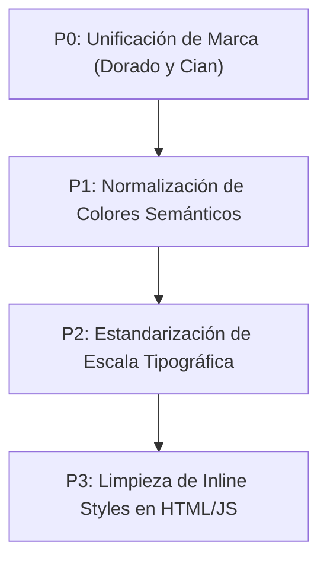

# Auditoría de Colores y Tipografía (Design System & Tokens) — AUTOPASS

**Fecha:** 2026-09-24 (diagnóstico) · actualizado 2026-09-27 (verificación P0 cerrada)  
**Alcance:** 41 archivos CSS (`static/css/`), 54 plantillas HTML (`templates/`), 62 módulos JavaScript (`static/js/`).  
**Estado:** Diagnóstico completo. **P0 (marca y tipografía) CERRADO** ✅ · P1–P3 con avance parcial (ver §5).

---

## 1. Resumen Ejecutivo y Diagnóstico Global

El sistema cuenta con un archivo central de tokens CSS (`static/css/base/variables.css`) introducido para la paleta **Champagne Gold & Royal Velvet** (v9.4.0+). Sin embargo, coexisten múltiples generaciones de estilos y código legado que eluden las variables CSS en favor de valores hexadecimales y RGB hardcodeados.

### Métricas Clave de la Auditoría
| Métrica | Valor Encontrado | Estado |
|---|:---:|:---:|
| **Archivos CSS analizados** | 41 | Base modular completa |
| **Plantillas HTML analizadas** | 54 | Módulos Jinja2 + modales |
| **Módulos JS analizados** | 62 | ES6 Modules + scripts puente |
| **Ocurrencias de Dorado Legado (`#C5A059` / `rgba(197, 160, 89, ...)`)** | **306** (264 en CSS, 42 en JS/HTML) | 🚨 **Crítico** (Desincronización de marca) |
| **Ocurrencias de Cian Legado (`#00D2FF` / `#00BCD4`)** | 3 en `monitoreo_live.html` | ⚠️ **Medio** |
| **Valores HEX únicos en CSS** | **121** colores diferentes | ⚠️ **Alto** (Falta de estandarización) |
| **Uso de variables CSS con `var()`** | 536 invocaciones totales | ⚠️ Desbalance: `--dorado` (340), resto < 40 |
| **Variables de estructura (`--bg-main`, `--bg-card`, `--text-primary`)** | < 5 usos c/u | ⚠️ Subutilización severa del design system |
| **Estilos en línea (`style=...`) con colores/fuentes en HTML** | **271** instancias | ⚠️ Violación del principio DRY y separación de capas |
| **Dispersión de tamaños tipográficos (`font-size`)** | **35+** valores distintos en rem/px | ⚠️ Anarquía tipográfica (solo 5 variables en CSS) |
| **Familias tipográficas declaradas** | Montserrat, Inter, JetBrains Mono, Share Tech Mono, Courier New, Consolas | ⚠️ Fuentes huérfanas y redundancia |

---

## 2. Auditoría de Color y Tokens Cromáticos

### 2.1 El Conflicto del Doble Dorado (Desincronización de Marca)
En `static/css/base/variables.css` (línea 5) la paleta oficial define:
```css
--dorado: #dfba6b;          /* DORADO PRINCIPAL (CHAMPAGNE) */
--dorado-hover: #edd193;    /* DORADO ILUMINADO */
--dorado-dark: #b89047;     /* DORADO OSCURO */
--dorado-glow: rgba(223, 186, 107, 0.15); /* GLOW */
```
**Hallazgo crítico:**  
En **264 lugares de CSS**, **29 lugares de JavaScript** y **13 de HTML** se sigue utilizando la fórmula cromática anterior:
- Hexadecimal: `#C5A059`
- RGB/RGBA: `rgba(197, 160, 89, 0.2)`, `rgba(197, 160, 89, 0.35)`, etc.

**Puntos críticos donde persiste el dorado viejo:**
1. **Badges institucionales** (`static/css/components/badges.css:27, 44, 62`): Roles admin, badges de estado pendiente/activa, warning.
2. **Botones** (`static/css/components/buttons.css:25, 74, 80`): Sombras y resplandores `box-shadow: rgba(197, 160, 89, ...)`.
3. **Toasts y alertas** (`static/css/style.css:74, 93, 136, 145`): Bordes, fondos y resplandores.
4. **Gráficos Chart.js** (`chart_window.js:202-204`, `dashboard-finance.js:237-257`, `estadisticas_ocr.js:30-37`): Líneas, puntos y fondos de gráficos usando `#C5A059` y `rgba(197, 160, 89, ...)`.
5. **Mapa Leaflet** (`landing-map.js:52, 62, 127, 157, 226, 300`, `landing-map-pois.js:26`): Botones de interacción, pins, buscador de localidades y bordes.
6. **Formulario de Reservas** (`reservas-form.js:582, 591, 593, 597`): HTML dinámico inyectado con `border-top: 2px solid rgba(197,160,89,0.2)` y `text-shadow: rgba(197,160,89,...)`.

---

### 2.2 Colores Semánticos (Éxito, Error, Advertencia, Información)
Se detectó una discrepancia recurrente entre los colores definidos en tokens y los utilizados en la práctica:

| Token Semántico | Valor Oficial (`variables.css`) | Valores Hardcodeados Competidores | Impacto |
|---|---|---|---|
| `--danger` | `#f43f5e` (Rose Red) | `#ef4444` (Tailwind Red - 31 veces en CSS, 7 en JS), `#e74c3c` (Flat Red - 6 en JS) | Inconsistencia en alertas, botones de eliminar y badges |
| `--success` | `#10b981` (Emerald) | `#2ecc71` (7 veces en CSS), `#27ae60` (6 en JS), `#4caf50` (Material Green) | Distintos verdes en aforo, tickets resueltos y confirmaciones |
| `--info` | `#3b82f6` (Blue Cobalto) | `#60a5fa` (12 veces en CSS), `#00bcd4` (Cyan en `monitoreo_live.html`) | Mezcla de azul cobalto con azul claro y cian legado |
| `--warning` | `#f59e0b` (Amber) | `#f39c12` (Flat Orange), o reemplazado por el dorado en badges | Ambigüedad entre advertencia y elemento dorado |

---

### 2.3 Subutilización de Tokens de Fondo y Texto
A pesar de contar con un esquema oscuro pulido en `variables.css`:
- `--bg-main: #08090c;` (Usado solo **3** veces en CSS)
- `--bg-card: #11141b;` (Usado solo **3** veces en CSS)
- `--bg-sidebar: #0b0d10;` (Usado solo **3** veces en CSS)
- `--bg-input: #1a1e26;` (Usado **0** veces directamente en CSS)
- `--text-primary: #f5f6f8;` (Usado solo **2** veces en CSS)
- `--text-secondary: #9ca3af;` (Usado solo **7** veces en CSS)
- `--text-muted: #6b7280;` (Usado solo **3** veces en CSS)

**Consecuencia:**  
Existen 123 declaraciones de `#fff`, 58 de `#000`, 37 de `#888`, 25 de `#666`, 20 de `#aaa`, 14 de `#555` y 13 de `#111` repartidas por 41 archivos. Esto dificulta enormemente ajustes globales de contraste, accesibilidad o futuros modos visuales.

---

### 2.4 Matriz de Accesibilidad y Contraste (WCAG 2.1 AA / AAA)

| Combinación Evaluada | Ratio de Contraste | Cumplimiento WCAG 2.1 AA | Diagnóstico |
|---|:---:|:---:|---|
| **Dorado `#dfba6b` sobre Fondo Oscuro `#08090c`** | **11.2:1** | ✅ **PASA (AAA)** | Óptimo para títulos, bordes y acentos sobre la app. |
| **Dorado `#dfba6b` sobre Blanco `#FFFFFF`** | **2.1:1** | ❌ **FALLA (< 4.5:1)** | Inadmisible para texto legible en tarjetas o modales claros. |
| **Dorado viejo `#C5A059` sobre Blanco `#FFFFFF`** | **2.7:1** | ❌ **FALLA (< 4.5:1)** | Falla criterio de accesibilidad. |
| **Texto secundario `#9ca3af` sobre `#08090c`** | **8.5:1** | ✅ **PASA (AAA)** | Muy legible en fondos oscuros. |
| **Gris `#888888` sobre `#11141b` (Tarjetas)** | **5.2:1** | ✅ **PASA (AA)** | Válido para texto normal. |
| **Gris apagado `#666666` sobre `#11141b`** | **3.1:1** | ❌ **FALLA (< 4.5:1)** | Ilegible para usuarios con baja visión en párrafos pequeños. |
| **Gris ultra-oscuro `#444` / `#555` para subtítulos** | **< 2.5:1** | ❌ **FALLA** | Debe reemplazarse por `var(--text-muted)`. |
| **Violeta `#8b5cf6` sobre Fondo `#08090c`** | **5.8:1** | ✅ **PASA (AA)** | Adecuado para botones secundarios y acentos VIP. |

---

## 3. Auditoría de Tipografía y Fuentes

### 3.1 Carga e Importación de Fuentes Web
1. **Importación Principal en `static/css/base/typography.css:1`**:
   ```css
   @import url('https://fonts.googleapis.com/css2?family=Montserrat:wght@400;700;800&family=Inter:wght@300;400;600;700&family=JetBrains+Mono:wght@500&display=swap');
   ```
   - Bien estructurado, combina Montserrat (títulos/marca), Inter (interfaz/lectura) y JetBrains Mono (código/números/patentes).
2. **Cargas Redundantes / Aisladas**:
   - `templates/monitoreo_live.html:20`:  
     `<link href="https://fonts.googleapis.com/css2?family=Share+Tech+Mono&display=swap" rel="stylesheet">`  
     *Problema:* Introduce una cuarta familia tipográfica exclusiva para un template, generando un request HTTP externo adicional sin respetar la identidad con `JetBrains Mono`.
   - `templates/emails/*.html`:  
     Importan por separado `Montserrat:wght@400;700;900` (correcto por tratarse de correos electrónicos transaccionales independientes).

---

### 3.2 Declaraciones de `font-family` en CSS
La regla global en `static/css/base/reset.css:5` establece:
```css
body { font-family: 'Montserrat', 'Inter', sans-serif; }
```
Sin embargo, se encontraron múltiples re-declaraciones redundantes o conflictivas:
- **`'Montserrat'` / `'Montserrat', sans-serif`**: Re-declarado **68 veces** en componentes y páginas (innecesario al heredarse de `body`).
- **`'Inter', sans-serif`**: Re-declarado 3 veces.
- **Tipografía Monoespaciada Fragmentada**:
  - `var(--font-mono)`: 18 veces.
  - `'Courier New', monospace`: 2 veces.
  - `'Consolas', 'Courier New', monospace`: 1 vez.
  - `'Montserrat', monospace`: 1 vez.
  - `'Share Tech Mono'`: Usado en `monitoreo_live.html`.
- **Uso de `!important` en fuentes**:  
  `'Montserrat', 'Inter', sans-serif !important;` (2 veces), forzando especificidad destructiva.

---

### 3.3 Fragmentación de la Escala Tipográfica (`font-size`)
La escala oficial en `variables.css` declara únicamente 5 escalones:
```css
--text-xs: 0.7rem;
--text-sm: 0.85rem;
--text-md: 1.1rem;
--text-lg: 1.4rem;
--text-xl: 2.5rem;
```
**Dispersión en el mundo real:**  
En lugar de emplear esta escala, los 41 archivos CSS utilizan **más de 35 valores de tamaño independientes**:
`0.5rem`, `0.6rem`, `0.65rem`, `0.68rem`, `0.7rem`, `0.72rem`, `0.75rem`, `0.78rem`, `0.8rem`, `0.82rem`, `0.85rem`, `0.88rem`, `0.9rem`, `0.95rem`, `1rem`, `1.05rem`, `1.1rem`, `1.15rem`, `1.2rem`, `1.25rem`, `1.3rem`, `1.4rem`, `1.5rem`, `1.6rem`, `1.8rem`, `2rem`, `2.2rem`, `2.5rem`...

**Top 5 tamaños más repetidos de forma manual:**
1. `0.85rem` (44 veces)
2. `0.9rem` (44 veces)
3. `0.75rem` (41 veces)
4. `0.7rem` (39 veces)
5. `0.65rem` (38 veces)

---

## 4. Auditoría de Estilos en Línea (HTML y JavaScript)

### 4.1 En Plantillas Jinja2 (`templates/`)
Se detectaron **271 apariciones de `style="..."`** aplicando colores, bordes o tamaños tipográficos de forma inline:
- **`templates/estadisticas_ocr.html`**: Más de 30 estilos directos con `color: #10b981;`, `color: #ef4444;`, `background: rgba(197, 160, 89, 0.15);`, `font-size: 0.85rem;`.
- **`templates/dashboard.html`**: Estilos en modales con `border: 1px solid rgba(197,160,89, 0.2);`, `color: var(--dorado);`.
- **`templates/monitoreo_live.html`**: Estilos con `border-color: #00bcd4;`, `color: #00bcd4;`.

### 4.2 En Módulos JavaScript (`static/js/`)
Módulos que generan markup dinámico insertan colores duros:
- **`static/js/modules/reservas-form.js`**:
  ```javascript
  // Líneas 582, 591, 597
  border-top: 2px solid rgba(197,160,89,0.2);
  text-shadow: 0 0 15px rgba(197,160,89,0.3);
  ```
- **`static/js/modules/landing-map.js`**:
  Manipula directamente los elementos del DOM alterando `btn.style.background = '#C5A059'`, `item.style.borderColor = '#C5A059'` y botones de zoom con colores hardcodeados.

---

## 5. Plan de Remediación Priorizado



### Prioridad P0: Unificación de Marca e Identidad Visual (Inmediato)
- [x] **Erradicar el dorado viejo `#C5A059` y `rgba(197, 160, 89, ...)`**: 0 residuales en código de producto (CSS/JS/HTML); reemplazo completo por `var(--dorado)`, `var(--dorado-glow)` y `rgba(223, 186, 107, ...)`. Verificación 2026-09-27: barrido en `static/css/**`, `static/js/**`, `templates/**` → 0. Únicos `#C5A059` que quedan: 55 en documentación/maquetas (49 `Diseno_Proyecto/diseno_completo.html`, 6 `Info proyecto/FUNCIONALIDADES.html`), fuera del alcance de producto.
- [x] **Eliminar el cian legado `#00bcd4`**: 0 residuales. Verificación: barrido global → 0; `templates/monitoreo_live.html` ya no declara ningún acento cian ni color hardcodeado.
- [x] **Unificar la tipografía monoespaciada**: eliminado el `<link>` de Google Fonts de Share Tech Mono; 0 residuales de "Share Tech Mono". Todos los cronómetros, slots ALPR, patentes y monotablas usan `var(--font-mono)` = `'JetBrains Mono', monospace` (36 usos en CSS + 3 en `estadisticas_ocr.js`). `monitoreo_live.html` verificado sin `fonts.googleapis`, sin `font-family` literal (hereda de `monitoreo-live.css`).

### Prioridad P1: Consistencia Semántica y Accesibilidad WCAG (Corto Plazo)
- [ ] **Normalizar la paleta de estados**:
  - Alinear el color de peligro / error a `--danger` (`#ef4444` o `#f43f5e`), suprimiendo los `#e74c3c`.
  - Alinear el color de éxito a `--success: #10b981`, eliminando `#2ecc71` y `#27ae60`.
- [ ] **Corregir ratios de contraste deficientes**:
  - Elevar cualquier texto gris `#666` en fondos oscuros a `--text-muted: #9ca3af` o `#888` para superar el umbral WCAG 2.1 AA (4.5:1).
  - Asegurar que nunca se use texto con `color: var(--dorado)` sobre fondos blancos o claros (usar fondos oscuros o texto negro/oscuro sobre contenedor dorado).

### Prioridad P2: Estandarización de la Escala Tipográfica (Medio Plazo)
- [ ] **Expandir la escala oficial en `variables.css`**:
  Definir una escala tipo Tailwind/Radix completa y semántica:
  ```css
  --text-2xs: 0.65rem;  /* 10.4px - Badges diminutos, timestamps secundarios */
  --text-xs:  0.75rem;  /* 12px   - Metadatos, labels auxiliares */
  --text-sm:  0.875rem; /* 14px   - Textos de interfaz y cuerpo compacto */
  --text-base: 1rem;    /* 16px   - Lectura estándar y párrafos */
  --text-md:  1.125rem; /* 18px   - Subtítulos destacados */
  --text-lg:  1.25rem;  /* 20px   - Títulos de tarjeta */
  --text-xl:  1.5rem;   /* 24px   - Títulos de sección */
  --text-2xl: 2rem;     /* 32px   - Encabezados principales */
  --text-3xl: 2.5rem;   /* 40px   - KPIs grandes y héroe */
  ```
- [ ] **Limpiar las declaraciones redundantes de `font-family`**:
  - Retirar los 68 `font-family: 'Montserrat'` dispersos, dejando que los contenedores hereden la fuente raíz declarada en `reset.css`.
  - Reemplazar `'Courier New'` y `'Consolas'` por `var(--font-mono)`.

### Prioridad P3: Desacoplamiento de Estilos Inline en HTML y JS (Medio Plazo)
- [ ] **Refactorizar `estadisticas_ocr.html` y `monitoreo_live.html`**:
  - Extraer estilos inline a sus respectivos archivos CSS (`static/css/pages/estadisticas_ocr.css` y `monitoreo-live.css`).
- [ ] **Módulo `theme.js` para JavaScript**:
  - Crear un módulo helper `static/js/modules/theme.js` que exponga la paleta de tokens a Chart.js y Leaflet:
    ```javascript
    export const THEME = {
        gold: '#dfba6b',
        goldGlow: 'rgba(223, 186, 107, 0.15)',
        goldBorder: 'rgba(223, 186, 107, 0.25)',
        bgCard: '#11141b',
        success: '#10b981',
        danger: '#ef4444',
        monoFont: "'JetBrains Mono', monospace"
    };
    ```
    Evitando strings mágicos de color en la lógica JS.
