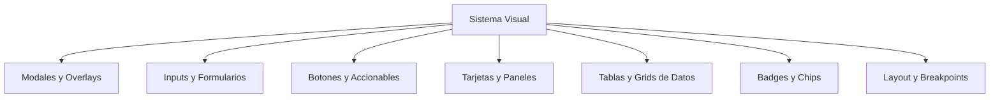
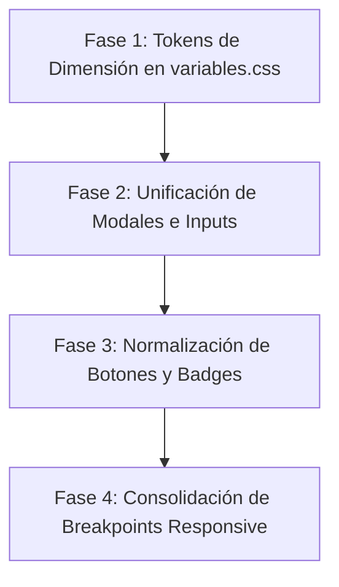

# Auditoría de Tamaños, Proporciones y Componentes Visuales — AUTOPASS

**Fecha:** 2026-09-24  
**Alcance:** 41 archivos CSS (`static/css/`), 54 plantillas HTML (`templates/`), 62 módulos JavaScript (`static/js/`).  
**Objetivo:** Analizar dimensiones, proporciones, espaciados, bordes redondeados, capas z-index, comportamientos adaptativos y coherencia volumétrica de todos los componentes visuales del sistema (modales, inputs, botones, tarjetas, tablas, badges y layouts).

---

## 1. Resumen Ejecutivo y Diagnóstico Global

El sistema de diseño visual de AUTOPASS posee una identidad estética definida (**Dark Luxury / Glassmorphic Obsidian**), pero adolece de una severa falta de gobernanza en sus dimensiones físicas. Al no existir un sistema de rejilla base (4px / 8px) ni variables para dimensiones y espaciados en `variables.css`, cada componente fue estilizado con valores manuales ad-hoc.

### Métricas Clave de la Auditoría Volumétrica
| Dimensión Analizada | Situación Detectada | Nivel de Riesgo |
|---|:---:|:---:|
| **Breakpoints en Media Queries** | **17 breakpoints distintos** (desde 400px hasta 1400px) | 🚨 **Alto** (Saltos y desajustes responsivos impredecibles) |
| **Escala de `border-radius`** | **23 valores distintos** (de 2px a 50px y 50%) | ⚠️ **Alto** (Fractura de identidad de formas) |
| **Alturas de Inputs (`input-premium`)** | Oscilan entre **42px, 46px, 48px, 50px y 54px** | ⚠️ **Alto** (Inconsistencia en formularios) |
| **Guerra de Capas (`z-index`)** | **15 valores arbitrarios** escalando hasta `99999` | ⚠️ **Medio/Alto** (Superposiciones y bugs de stacking) |
| **Conflicto en Modales (`max-width`)** | `.modal-content-wide` mide 550px en modales y 800px en perfil | ⚠️ **Medio** (Sobrescrituras destructivas) |
| **Gaps en Flexbox y Grids** | **15 valores distintos** (mezcla de pares e impares: 5px, 6px, 14px, 15px, 18px...) | ⚠️ **Medio** (Falta de ritmo vertical/horizontal) |
| **Familia de Botones** | Convivencia caótica de botones **píldora** (50px) con botones **rectangulares** (8px/12px) | ⚠️ **Medio** (Incoherencia semántica) |

---

## 2. Auditoría por Componente Visual



---

### 2.1 Modales y Cuadros de Diálogo (`modals.css`, páginas y modales dinámicos)

Los modales constituyen el núcleo transaccional de AUTOPASS (login, registro, reservas, creación de sucursales, cobro en caja, edición de usuarios, tickets).

#### A. Dispersión de Anchos (`max-width`)
En `static/css/components/modals.css`:
- `.modal-content` (Base): `max-width: 450px;` (width: 90%)
- `.modal-content-wide`: `max-width: 550px;`
- `.modal-content-large`: `max-width: 680px;` (width: 94%)
- `.confirm-modal-content`: `max-width: 400px;`
- `.choice-modal-content`: `max-width: 420px;`

**Conflicto de Sobrescritura Detectado:**
- En `static/css/pages/profile/profile-base.css:67`:  
  ```css
  .modal-content-wide { max-width: 800px; } /* ¡Sobrescribe a modals.css (550px)! */
  ```
- En `static/css/pages/dashboard/dashboard-admin-tour.css:203`:  
  ```css
  .admin-help-modal-content { max-width: 900px !important; }
  ```
- En `static/css/pages/dashboard/dashboard-tables.css:364`:  
  ```css
  #modal-ticket-answer .modal-content { max-width: 680px; }
  ```

#### B. Altura y Control de Desbordamiento (`overflow-y`)
- **Problema de Scroll:**  
  `.modal-content` define `margin: 5% auto; padding: 40px; border-radius: 20px;` pero **no tiene `max-height` definido**.
  En pantallas compactas (laptops de 1366×768 o con zoom del navegador al 125%), modales extensos como el alta de reserva o edición de sucursal dependen exclusivamente del scroll de la capa de fondo `.modal { overflow-y: auto; }`. Esto hace que el modal completo se mueva en el eje vertical en vez de mantener fijas la cabecera y el footer de acciones mientras scrollea el cuerpo.
- **Excepción Positiva:**  
  Solo `.modal-content-large .modal-body` implementa `max-height: calc(100vh - 200px); overflow-y: auto;`. Este patrón debe universalizarse.

#### C. Proporciones y Paddings de Modales
- `padding: 40px;` resulta excesivo en tablets y móviles, reduciendo drásticamente el área útil.
- Botón de cierre (`.close-btn`): `width: 35px; height: 35px; top: 15px; right: 15px;`. Área táctil de 35px, inferior a los 44px recomendados por WCAG 2.5.5 para dispositivos móviles.

---

### 2.2 Inputs, Selectores y Formularios (`forms.css`, `profile-*.css`, `dashboard-*.css`)

#### A. La Anarquía de las Alturas de Input
No existe una altura estándar definida para los campos de entrada:
| Selector / Archivo | Altura Computada / Declarada | Padding Declarado |
|---|:---:|:---:|
| `input, select, textarea` (`forms.css:11`) | ~50px (sin height fijo) | `padding: 15px;` |
| `.input-premium` (`profile-reservations.css:82`) | **48px** explícito | `padding: 12px 15px;` |
| `.input-premium` (`profile-tour.css:1618`) | **42px** (`2.625rem !important`) | `padding: 8px 12px;` |
| `.admin-help-search-input` (`dashboard-admin-tour.css:319`) | **46px** explícito | `padding: 12px 20px;` |
| `.help-search-input` (`profile-help.css:79`) | **54px** explícito | `padding: 15px 22px;` |
| `.input-premium-sm` (`dashboard-settings.css:109`) | **32px** / **34px** | `padding: 6px 10px;` |

**Impacto:**  
En un mismo formulario con fecha, selector de sucursal y patente, los campos difieren en altura según de qué archivo CSS carguen su especificidad.

#### B. Border-radius en Formularios
- Campos estándar: `12px`
- Cajas de búsqueda: `10px`
- Flatpickr / selectores de tiempo: `8px !important`
- Inputs pequeños de ajustes: `5px`
- Inputs de capacidad / precios: `8px`

#### C. Selectores y Dropdowns
`.select-premium` (`forms.css:67-83`) incorpora un chevron SVG en base64 con el dorado viejo hardcodeado (`stroke='%23C5A059'`). Además, el padding derecho de `45px` necesario para el icono no siempre se respeta en las variantes móviles.

---

### 2.3 Botones y Disparadores de Acción (`buttons.css`, componentes varios)

#### A. Fractura Morfológica: ¿Píldora o Rectángulo Redondeado?
El sistema tiene dos líneas de diseño enfrentadas para botones:
1. **Línea Píldora (`border-radius: 50px` / `30px`)**:
   - `.btn`: `padding: 15px 35px; border-radius: 50px;`
   - `.btn--premium`: `padding: 14px 28px; border-radius: 50px;`
   - `.btn--premium--sm`: `padding: 8px 18px; border-radius: 30px;`
2. **Línea Rectángulo Redondeado (`border-radius: 8px` / `12px` / `16px`)**:
   - `.btn--sm`: `padding: 8px 18px; border-radius: 8px;`  
     *(¡Grave incoherencia! El tamaño normal de `.btn` es píldora, pero su variante `.btn--sm` es rectangular).*
   - `.btn--mini`: `padding: 4px 10px; border-radius: 8px;`
   - `.btn-oauth`: `padding: 12px 16px; border-radius: 12px;`
   - `.action-btn-premium`: `padding: 12px 24px; border-radius: 16px;`

#### B. Proporciones y Accesibilidad Táctil (Touch Targets)
- `.btn--mini` (`padding: 4px 10px; font-size: 0.75rem;`): Altura total de apenas **26px**. En pantallas táctiles es muy propenso a toques erróneos (falla WCAG 2.5.5 target size $\ge 44 \times 44$ px).
- Botones circulares `.btn--icon`: `width: 40px; height: 40px;` (bien proporcionados para desktop, al límite en móvil).
- Botón flotante FAB (`.fab-btn`): `width: 56px; height: 56px; border-radius: 50%;` (proporción óptima Material/iOS).

---

### 2.4 Tarjetas, Paneles y Contenedores (`cards.css`, `dashboard-cards.css`, páginas)

#### A. Proporciones y Radios de Tarjetas
| Tipo de Tarjeta | Padding | Border Radius | Comportamiento Hover |
|---|:---:|:---:|---|
| `.card` (Base) | `25px` | `16px` | Sin transform, solo cambia borde |
| `.stat-card` | `22px 25px` | `16px` | `transform: translateY(-2px);` |
| `.stat-card-premium` | `20px` | `20px` | `transform: translateX(5px);` |
| `.vehicle-stat-card` (v9.14.1) | `16px` | `14px` | `transform: translateY(-2px);` |
| `.card-feature` (Landing) | `30px 25px` | `18px` | `transform: translateY(-5px);` |

**Inconsistencia:**  
Tres comportamientos distintos en hover (sin movimiento, traslación vertical y traslación horizontal) y radios oscilando entre 14px y 20px.

---

### 2.5 Tablas de Datos (`tables.css`, `dashboard-tables.css`)

- **Densidad de Información:**
  - Encabezados `th`: `padding: 15px; font-size: 0.75rem;`
  - Celdas `td`: `padding: 20px 15px; font-size: 0.9rem;`
  - En tablas con volumen de datos (historial de accesos, reservas, auditoría financiera), una altura de fila de ~65px genera una densidad muy baja, obligando a scroll continuo.
- **Ancho Mínimo y Scroll Horizontal:**
  - Las tablas están contenidas en wrappers con `overflow-x: auto`. Sin embargo, varias tablas del dashboard admin carecen de `min-width` explícito en las columnas de acción o estado, lo que provoca que al achicar la pantalla las columnas colapsen o queden truncadas antes de activar la barra de desplazamiento.

---

### 2.6 Badges y Chips de Estado (`badges.css`, `header.css`)

| Tipo de Badge | Dimensiones / Padding | Border-Radius | Tipografía |
|---|:---:|:---:|:---:|
| `.role-badge` | `5px 12px` | `6px` | 0.7rem |
| `.badge-status` | `5px 12px` | `6px` | 0.75rem |
| `.badge` genérico | `5px 12px` | `6px` | 0.75rem |
| `.balance-badge`, `.points-badge` | `8px 16px` | **`50px` (Pill)** | 0.85rem |
| `.admin-badge` (Header) | `8px 15px` | `12px` | 0.8rem |
| `.vt-fab-badge` (Virtual Time) | `1px 4px` | `4px` | 0.6rem |

Existe una marcada disparidad entre los badges de rol/estado (rectangulares de 6px) y los badges de saldo/puntos (píldoras de 50px).

---

## 3. Auditoría de Rejilla, Espaciados y Capas

### 3.1 Gaps en Grids y Flexbox (Falta de Sistema 4/8px)
Se detectaron **15 valores distintos de `gap`** a lo largo de las hojas de estilo:
- Valores múltiplos de 4/8: `4px` (12 veces), `8px` (63 veces), `12px` (39 veces), `16px` (6 veces), `20px` (42 veces).
- Valores disonantes/impares: `2px` (7 veces), `5px` (13 veces), `6px` (27 veces), `10px` (62 veces), `14px` (15 veces), `15px` (43 veces), `18px` (6 veces), `25px` (11 veces), `30px` (13 veces).

### 3.2 La Guerra de Capas (`z-index`)
El proyecto no cuenta con una escala de apilamiento unificada. Los valores de `z-index` se fueron incrementando para resolver problemas de superposición puntuales:
```
1 → 2 → 5 → 10 → 100 → 1000 → 1001 → 1100 → 2000 → 2100 → 3000 → 9999 → 10000 → 10003 → 99999
```

**Conflictos Clave:**
1. `.sidebar`: `z-index: 1000`
2. `.sidebar-toggle`: `z-index: 1000`
3. `.modal`: `z-index: 3000`
4. `#toast-container`: `z-index: 10000`
5. `.vt-fab-container` (Virtual Time): `z-index: 9999`
6. Overlays de Tour (`admin-tour` y `tour.js`): `z-index: 10003` y `99999`

---

## 4. Auditoría de Breakpoints y Comportamiento Responsive

Se detectaron **17 breakpoints diferentes** en las reglas `@media (max-width: ...)`:

```
[400px]  [480px]  [500px]  [560px]  [580px]  [600px]  [640px]  [650px]  [680px]
  └─────────────────────────── ZONA MÓVIL (9 variantes) ───────────────────────────┘

[768px]  [769px]  [800px]  [992px]  [1024px]
  └─────────────── ZONA TABLET (5 variantes) ───────────────┘

[1100px]  [1200px]  [1400px]
  └─────── ZONA DESKTOP ───────┘
```

**Problemas causados por la fragmentación de breakpoints:**
- En un viewport de **590px**: un componente colapsó (a 600px), pero otro aún no (espera a 580px o 560px), produciendo solapamientos o desbordes horizontales intermedios.
- Coexistencia de `768px` (22 veces) y `769px` (1 vez).
- Coexistencia de `640px` (3 veces) y `650px` (3 veces).

---

## 5. Plan de Normalización y Estandarización



### Fase 1: Creación de Tokens Volumétricos en `variables.css`
Añadir a `static/css/base/variables.css`:

```css
:root {
    /* --- ESCALA DE RADIOS (BORDER-RADIUS) --- */
    --radius-xs: 4px;
    --radius-sm: 8px;
    --radius-md: 12px;
    --radius-lg: 16px;
    --radius-xl: 20px;
    --radius-full: 9999px;

    /* --- ALTURAS ESTÁNDAR DE CONTROLES --- */
    --control-height-sm: 36px;  /* Botones compactos, inputs de tabla */
    --control-height-md: 46px;  /* Altura estándar (inputs, selects, botones base) */
    --control-height-lg: 54px;  /* Buscadores hero, CTA principales */

    /* --- SISTEMA DE CAPAS (Z-INDEX) --- */
    --z-base: 1;
    --z-dropdown: 100;
    --z-sticky: 500;
    --z-sidebar: 1000;
    --z-modal-backdrop: 2000;
    --z-modal: 2010;
    --z-toast: 3000;
    --z-tour: 4000;

    /* --- ANCHOS DE MODALES --- */
    --modal-sm: 420px;   /* Confirmaciones, alertas */
    --modal-md: 520px;   /* Formularios estándar (login, vehículo) */
    --modal-lg: 680px;   /* Formularios complejos (sucursal, tickets) */
    --modal-xl: 900px;   /* Ayuda admin, monitoreo extendido */
}
```

### Fase 2: Unificación de Modales e Inputs
1. **Modales:**
   - Estandarizar `.modal-content` con `--radius-xl` (20px), padding responsive (`30px` desktop / `20px` mobile).
   - Eliminar la sobrescritura accidental de `.modal-content-wide` en `profile-base.css:67` unificándola con la variable `--modal-lg`.
   - Incorporar a todos los modales el patrón:
     ```css
     .modal-content { max-height: calc(100vh - 80px); display: flex; flex-direction: column; }
     .modal-body { overflow-y: auto; flex: 1; }
     ```
2. **Inputs:**
   - Unificar `.input-premium`, `.select-premium` y campos base con `height: var(--control-height-md); border-radius: var(--radius-md);`.
   - Suprimir `height: 2.625rem !important;` en `profile-tour.css`.

### Fase 3: Coherencia en Botones y Badges
1. **Botones:**
   - Definir si los botones estándar son **píldora** o **rectangulares con radio**:
     - Si se adopta la píldora: `.btn`, `.btn--sm`, `.btn--premium` deben usar `--radius-full`.
     - Si se adopta el estilo glassmorphic moderno: usar `--radius-md` (12px) de forma homogénea en toda la app.
   - Elevar el área de toque de `.btn--mini` agregando un pseudo-elemento `::before` de 40px para accesibilidad táctil.
2. **Badges:**
   - Unificar todos los badges informativos y de rol en `--radius-sm` (8px) con `padding: 4px 10px;`.
   - Reservar el estilo píldora (`--radius-full`) exclusivamente para medidores numéricos (puntos, saldo).

### Fase 4: Consolidación de Breakpoints
Reducir los 17 breakpoints a los **4 estándares universales**:
- **Mobile (`sm`):** `640px` (absorbe 400, 480, 500, 560, 580, 600)
- **Tablet (`md`):** `768px` (absorbe 650, 680, 769, 800)
- **Laptop (`lg`):** `1024px` (absorbe 992, 1100)
- **Desktop Wide (`xl`):** `1280px` (absorbe 1200, 1400)
