# Auditoría Integral de UX / UI — AUTOPASS

> **Fecha:** 2026-09-22  
> **Versión auditada:** v9.32.2 (rama `main`)  
> **Alcance:** Todas las interfaces web del sistema: Landing (`index.html`, `nuestra-red.html`, `contacto.html`), Portal del Cliente (`perfil.html`, 7 tabs), Panel Administrativo (`dashboard.html`, 10 tabs), Monitoreo CCTV (`monitoreo_live.html`), Modales (`auth_modals.html`, `modals.html`), Estilos (`static/css/**`) y Módulos de Interacción (`static/js/modules/**`).  
> **Metodología:** Evaluación Heurística de Jakob Nielsen (10 principios), WCAG 2.1 (Niveles A / AA), Inspección de Arquitectura de Información, Flujos de Tarea (User Journeys) y Responsive Design.

---

## 1. Resumen Ejecutivo

AUTOPASS presenta una identidad visual distintiva y de alta gama (**"Obsidian & Champagne Gold"** con acento **"Royal Velvet"**), apoyada en una arquitectura frontend completamente modularizada (62 módulos JS ES6 y 22 archivos CSS desacoplados). 

La experiencia de usuario está notablemente madura para un sistema operativo de estacionamiento inteligente:
- Dispone de **tours interactivos de onboarding** tanto para clientes como para administradores (`tour.js`, `admin-tour.js`).
- El flujo de reserva contempla **estados vacíos asistidos** (ej. alta rápida de vehículo si el cliente no tiene ninguno).
- La visualización de datos en móviles resuelve la densidad de tablas complejas convirtiéndolas dinámicamente en **tarjetas verticales** con pseudo-etiquetas `data-label`.
- El sistema de retroalimentación (**toasts glassmorphism**, spinners en botones, badges con pulsaciones CSS) proporciona visibilidad constante del estado del sistema.

### Calificación Global por Dimensión

| Dimensión | Puntuación (1 a 10) | Estado | Observación Principal |
|---|:---:|:---:|---|
| **1. Identidad Visual & Design System** | **8.5 / 10** | 🟢 Sólido | Tokens CSS claros en `variables.css`. Oportunidad: eliminar estilos inline residuales y unificar clases de botones. |
| **2. Arquitectura de Información (IA)** | **9.0 / 10** | 🟢 Excelente | Separación nítida entre Portal Cliente (7 áreas) y Dashboard Admin (10 áreas) con routing por tabs. |
| **3. Flujos Críticos de Usuario (UX)** | **8.8 / 10** | 🟢 Muy Bueno | Reserva, pago con Mercado Pago / Saldo, pase digital QR y gestión de vehículos sin callejones sin salida. |
| **4. Retroalimentación & Prevención de Errores** | **8.7 / 10** | 🟢 Muy Bueno | Spinners en botones async, confirmaciones en acciones destructivas y validación de contraseñas interactiva. |
| **5. Responsive Design & Mobile UX** | **8.0 / 10** | 🟡 Bueno | Card layout en tablas móvil excelente; convivencia de doble barra en móvil (sidebar + bottom nav) a pulir. |
| **6. Accesibilidad (WCAG 2.1)** | **7.5 / 10** | 🟡 Regular / Bueno | Ratio labels/inputs saludable (1.27); contraste de dorado `#C5A059` sobre fondos claros/violetas requiere ajuste. |

---

## 2. Evaluación según las 10 Heurísticas de Jakob Nielsen

### H1. Visibilidad del estado del sistema — [Calificación: 9/10]
- **Fortalezas:**
  - En el Dashboard de Administración, el header cuenta con un `health-dot` con estado de salud de la base de datos (`#health-db`) y un reloj sincronizado en tiempo real (`#clock`).
  - Botones de acción asíncrona (login, registro, pagos, canje de vouchers) inyectan un spinner `<i class="fas fa-circle-notch fa-spin"></i>` y deshabilitan el botón (`disabled = true`) para evitar doble submit.
  - Centro de notificaciones con badge animado (`.notif-badge.pulse`) que late cuando hay mensajes no leídos.
  - Monitoreo en vivo CCTV muestra indicador de cámara `ONLINE` / `OFFLINE` y HUD con la patente detectada en tiempo real.
- **Oportunidad de mejora:**
  - En la carga de tablas con gran volumen de registros (ej. historial financiero o logs de accesos), agregar esqueletos de carga (*skeleton loaders*) en lugar del texto plano `"Cargando reservas..."`.

### H2. Coincidencia entre el sistema y el mundo real — [Calificación: 9.5/10]
- **Fortalezas:**
  - El lenguaje utilizado es natural y contextualizado al dominio: *"Patente"*, *"Barrera"*, *"Plaza"*, *"Estadía"*, *"Pase Digital"*, *"Tiempo de cortesía"*.
  - Las patentes se renderizan con la estética visual de la placa metálica real (chapa patente Mercosur y formato tradicional).
  - Íconos coherentes de FontAwesome para motos, autos y camionetas.

### H3. Control y libertad del usuario — [Calificación: 8.5/10]
- **Fortalezas:**
  - Todos los modales admiten cierre mediante botón `x`, clic en el backdrop oscuro o presionando la tecla `Escape`.
  - El usuario puede cancelar una reserva vigente con devolución automática de saldo si se encuentra dentro de la política horaria.
  - Posibilidad de deshacer canjes de tickets promocionales no utilizados.
- **Oportunidad de mejora:**
  - En el proceso de reserva manual, si el usuario desea cambiar de sucursal a mitad del formulario, se restablece el formulario completo. Se beneficiaría de un stepper visual explícito (1. Sede → 2. Vehículo → 3. Horario → 4. Pago).

### H4. Consistencia y estándares — [Calificación: 8.0/10]
- **Fortalezas:**
  - Sistema de tokens unificado en `static/css/base/variables.css` (`--dorado`, `--violet-brand`, `--bg-main`, `--text-primary`, `--success`, `--danger`, etc.).
  - Comportamiento idéntico de modales a lo largo de toda la aplicación vía `ui.js` (`openModal`, `closeModal`, `switchModal`).
- **Oportunidad de mejora:**
  - Conviven variantes de botones con nomenclaturas paralelas: `.btn-primary`, `.btn-premium`, `.btn-action-mini`, `.btn-icon-premium`. Se sugiere consolidar bajo una única jerarquía BEM: `.btn--primary`, `.btn--secondary`, `.btn--icon`.
  - Se detectaron estilos inline (`style="..."`) residuales en `templates/profile/tabs/inicio.html` y `templates/dashboard.html` que sobreescriben colores con valores hexadecimales fijos en lugar de invocar las variables CSS.

### H5. Prevención de errores — [Calificación: 9.0/10]
- **Fortalezas:**
  - Validación de patentes en tiempo real: impide caracteres inválidos y formatea automáticamente según el estándar argentino/Mercosur.
  - Validación interactiva de contraseñas durante el registro con medidor de complejidad y lista de requisitos (longitud, mayúscula, carácter especial, coincidencia) con tildes visuales reactivos.
  - Deshabilitación de botones de acción destructiva cuando no aplican (ej. el botón "Borrar notificaciones" se deshabilita si no hay notificaciones leídas).
  - Diálogos de confirmación (`showConfirm`) previos a la eliminación de vehículos o cancelación de tickets.

### H6. Reconocimiento antes que recuerdo — [Calificación: 9.0/10]
- **Fortalezas:**
  - Tours guiados paso a paso con resaltado de elementos para usuarios nuevos (`tour.js`) y operadores del dashboard (`admin-tour.js`).
  - Si un usuario no tiene vehículos registrados al entrar al módulo de reservas, la interfaz despliega automáticamente un panel contextual de alta rápida sin obligarlo a navegar a otra pestaña.
  - El Pase Digital resume toda la información clave en un solo golpe de vista: QR, código alfanumérico, dirección de la sucursal, horario, patente y estado del pago.

### H7. Flexibilidad y eficiencia de uso — [Calificación: 8.5/10]
- **Fortalezas:**
  - Selector de vehículo favorito para pre-seleccionar automáticamente en reservas futuras.
  - Acciones rápidas de apertura manual de barreras para operadores y guardias en el panel de monitoreo.
  - Filtros avanzados de historial por rango de fechas ("Desde" y "Hasta") con botón de reseteo rápido.
  - Atajos de teclado en modales y navegación accesible.

### H8. Estética y diseño minimalista — [Calificación: 8.5/10]
- **Fortalezas:**
  - Look & Feel moderno estilo *Dark Mode Premium*: fondo Obsidian (`#08090c`), bordes de vidrio translúcido (`backdrop-filter: blur`), tipografía técnica `JetBrains Mono` y de títulos `Montserrat`.
  - El panel de CCTV (`monitoreo_live.html`) utiliza tipografía digital `Share Tech Mono` simulando una consola de videovigilancia industrial.
- **Oportunidad de mejora:**
  - En la pestaña de inicio de cliente, la densidad de elementos en el grid (formulario de reserva + mapa interactivo + bienvenida) puede sobrecargar la pantalla en resoluciones medianas (1024px–1280px).

### H9. Ayuda a reconocer, diagnosticar y recuperarse de errores — [Calificación: 8.5/10]
- **Fortalezas:**
  - Mensajes de error claros e informativos en formularios en español neutro (evita tecnicismos como "Internal Server Error" o "HTTP 422").
  - Toasts de alerta contextuales con código de color semántico (rojo para error, verde para éxito, ámbar para advertencias).

### H10. Ayuda y documentación — [Calificación: 9.5/10]
- **Fortalezas:**
  - Pestaña dedicada "Ayuda y Soporte" con sistema de tickets bidireccional (soporte al cliente con subida de adjuntos y respuestas del staff).
  - Acordeón interactivo de Preguntas Frecuentes (FAQ) con buscador en vivo.
  - Tours interactivos re-ejecutables en cualquier momento desde el menú lateral.

---

## 3. Análisis de Flujos de Usuario (User Journeys)

```mermaid
flowchart TD
    subgraph Cliente ["Portal Cliente (Conductor)"]
        A[Landing / App] --> B{¿Tiene Cuenta?}
        B -- No --> C[Registro Asistido con Password Meter]
        B -- Sí --> D[Login con Recordatorio / Google OAuth]
        C --> D
        D --> E[Portal de Inicio]
        E --> F{¿Tiene Vehículo?}
        F -- No --> G[Alta Rápida de Vehículo en Reserva]
        F -- Sí --> H[Selección Sede + Plazas Trimodales]
        G --> H
        H --> I[Cálculo de Tarifa Reactivo]
        I --> J{Método de Pago}
        J -- Saldo Insuficiente --> K[Modal Recarga Mercado Pago]
        K --> J
        J -- Saldo OK / MP Directo --> L[Emisión de Pase Digital con QR]
        L --> M[Apertura por Patente / Lector QR en Entrada]
    end

    subgraph Operador ["Panel Admin / Operador"]
        O[Dashboard Operativo] --> P[Monitoreo CCTV en Vivo]
        P --> Q[Lectura ALPR Automática]
        Q --> R{¿Placa Habilitada?}
        R -- Sí --> S[Apertura Automática + Log]
        R -- Duda / No --> T[Apertura Manual de Barrera 1-Click]
        O --> U[Gestión de Aforo por Pisos]
        O --> V[Atención de Tickets de Soporte]
    end
```



### Puntos de Fricción Identificados en los Flujos

1. **Flujo de Pago y Carga de Saldo:**
   - Si el usuario opta por pagar una reserva con saldo pero no dispone de fondos suficientes, el modal de recarga abre la pasarela de Mercado Pago. Al retornar, la reserva permanece en estado "impaga" en la pestaña de reservas. Sería más fluido que el sistema reintente automáticamente el débito de la reserva pendiente una vez acreditado el saldo.
2. **Navegación Móvil Dual:**
   - En smartphones conviven el botón hamburguesa superior (`.mobile-nav-toggle`) que despliega el sidebar completo y la barra de navegación fija inferior (`.user-footer-nav`). Si bien el bottom nav agiliza el pulgar, duplica opciones (Inicio, Reservas, Perfil). Se recomienda que el bottom nav contenga las 4 acciones de mayor frecuencia (Inicio, Reservas, Mi QR, Ayuda) y el sidebar concentre configuración y cierre de sesión.

---

## 4. Auditoría de Accesibilidad (WCAG 2.1 AA)

| Criterio WCAG | Estado | Hallazgo | Remedio Propuesto |
|---|:---:|---|---|
| **1.4.3 Contraste (Mínimo)** | 🟡 Advertencia | El dorado institucional `#C5A059` sobre fondo blanco tiene contraste ~2.7:1 y sobre violeta ~1.3:1 (requiere 4.5:1 para texto normal). | Usar `#C5A059` solo en bordes/íconos decorativos. Para texto institucional sobre fondos oscuros o violetas, utilizar el tono claro `#F2E3BF` (ratio 5.5:1). |
| **2.4.7 Foco Visible** | 🟡 Advertencia | Solo 1 de 42 archivos CSS declara `:focus-visible`. Navegadores dependen del outline default del SO. | Incorporar en `base.css`: `:focus-visible { outline: 2px solid var(--violet-brand); outline-offset: 2px; }`. |
| **1.3.1 Info & Relaciones (Labels)** | 🟢 Aprobado | 176 labels/aria-labels frente a 139 inputs (ratio 1.27 > 1.0). Todos los inputs clave tienen asociación `for="id"`. | Mantener el estándar en futuros formularios. |
| **2.1.1 Teclado** | 🟢 Aprobado | Modales capturan la tecla `Escape` y navegan con `Tab`. Botones accesibles vía `Enter` y `Espacio`. | Agregar `autofocus` al primer campo interactivo al abrir cada modal. |
| **2.5.5 Tamaño del objetivo táctil** | 🟢 Aprobado | Botones principales y badges interactivos superan los 44x44px recomendados para dispositivos táctiles. | Asegurar que los botones `.btn-icon-premium.sm` en mobile mantengan un padding de toque de al menos 40px. |

---

## 5. Matriz de Priorización de Mejoras UI/UX

```
 IMPACTO
    ▲
    │  [P1] Skeleton loaders en tablas
Alto│  [P0] Corrección de contraste texto dorado (#F2E3BF)
    │  [P1] Unificación de navegación móvil (Sidebar vs Bottom Bar)
    │  [P2] Stepper visual en proceso de reserva
    │
Med.│  [P2] Anillo de foco global :focus-visible
    │  [P3] Consolidación de clases de botones BEM
    │  [P3] Sticky action-bar en modales largos de mobile
    │
    └────────────────────────────────────────────────────────► ESFUERZO
           Bajo                 Medio                  Alto
```

### Detalle de Acciones Recomendadas:

#### Prioridad P0 (Inmediata — Alto impacto, Bajo esfuerzo)
1. **Contraste de Tipografía Acentuada:**
   - Reemplazar el color de texto `#C5A059` en `profile-base.css:575` y `profile-reservations.css:221` por `--text-primary` (`#f5f6f8`) o dorado claro `#F2E3BF` para garantizar cumplimiento WCAG AA.
2. **Anillo de Foco Global Accesible:**
   - Declarar `:focus-visible` unificado con `--violet-brand` en `static/css/base/reset.css` o `style.css`.

#### Prioridad P1 (Corto Plazo — Alto impacto, Medio esfuerzo)
3. **Skeleton Loaders en Tablas y Grids:**
   - Implementar placeholders animados en tarjetas de reservas, tabla de usuarios y logs de monitoreo para sustituir textos estáticos de *"Cargando..."*.
4. **Sincronización y Jerarquía en Navegación Móvil:**
   - Definir con precisión el rol del *Bottom Navigation Bar* (`.user-footer-nav`) como barra primaria de pulgar (Home, Reservas, Pase QR, Notificaciones) y reservar el menú hamburguesa para opciones secundarias de cuenta y soporte.

#### Prioridad P2 (Medio Plazo — Experiencia de Usuario Avanzada)
5. **Stepper Asistido en Reserva:**
   - Incorporar indicador de progreso (Paso 1: Sede → Paso 2: Plaza → Paso 3: Tarifa → Paso 4: Pase) para dar mayor previsibilidad al usuario.
6. **Autofocus en Modales:**
   - Asegurar que al dispararse cualquier modal (`loginModal`, `registerModal`, `rechargeModal`), el cursor se posicione automáticamente en el primer input.

#### Prioridad P3 (Refactor Visual / Deuda Técnica CSS)
7. **Limpieza de Estilos Inline:**
   - Mudar declaraciones de estilo en línea en los templates hacia clases reutilizables en `static/css/components/`.
8. **Estandarización de Botones:**
   - Unificar `.btn-premium`, `.btn-action-mini` y `.btn-primary` bajo un único componente CSS con modificadores de tamaño y variante.

---

## 6. Conclusión de la Auditoría

La interfaz de usuario de **AUTOPASS** se encuentra en un estado **muy avanzado y profesional**, alineada con el nivel de ingeniería de su backend y su suite de tests. Cuenta con un diseño elegante, coherente con su propuesta de valor tecnológica, y con soluciones creativas para problemáticas complejas como la visualización de cámaras de seguridad y la adaptación de tablas de datos a pantallas móviles.

Las oportunidades de mejora detectadas no corresponden a fallas estructurales, sino a refinamientos de **accesibilidad fina (contraste y foco)**, **consistencia en la arquitectura de estilos (reducir inline CSS)** y **optimización del flujo táctil en smartphones**.

---

## 7. Estado de Implementación (Progreso del Plan)

| Ítem | Estado | Implementación | Evidencia |
|---|:---:|---:|---|
| **P0.1** Contraste tipografía dorada | ✅ Hecho | Texto institucional pasa a dorado claro `#F2E3BF`; `#C5A059` queda solo en bordes/íconos decorativos. | Auditoría A8 (v9.33.0) |
| **P0.2** Anillo de foco global `:focus-visible` | ✅ Hecho | Regla global con `--violet-brand`. | `profile-base.css:574` |
| **P1.3** Skeleton loaders en tablas y grids | ✅ Hecho | Componente reutilizable `skeleton.css` (`.skeleton`, `.skeleton-cells`, `.skeleton-card`, `.skeleton-grid`, shimmer). Aplicado en tablas de admin (reservas, usuarios, finanzas, sucursales, promociones, tickets) y tarjetas/historial del cliente (reservas). | `static/css/components/skeleton.css`, `base.html`, templates `dashboard/tabs/*` y `profile/tabs/reservas.html` |
| **P1.4** Jerarquía de navegación móvil | ✅ Hecho | `user-footer-nav` pasa a 4 accesos primarios: Inicio, Reservas, Pase QR, Notificaciones. El atajo Pase QR abre el Pase Digital de la reserva en curso (`openCurrentPass`) y el hamburguesa queda para las opciones secundarias. | `perfil.html`, `perfil.js` |
| **P2.5** Stepper asistido en reserva | ✅ Hecho | Indicador de progreso 4 pasos (Vehículo → Sucursal → Horario → Confirmación) con estados activo/completado; se sincroniza con cambios de vehículo, sucursal, tipo, fecha y cálculo del total. | `inicio.html`, `profile-base.css`, `reservas-form.js`, `reservas-form-price.js` |
| **P2.6** Autofocus en modales | ✅ Hecho | `openModal` enfoca el primer campo editable visible (input/select/textarea), con fallback a email. | `modules/ui.js` |
| **P3.7** Limpieza de estilos inline | ✅ Hecho (parcial acotado) | Título centrado repetido en `inicio.html` extraído a clase `section-title-premium--center`. Resto de inline de `dashboard.html` queda para iteración futura. | `inicio.html`, `profile-base.css` |
| **P3.8** Estandarización BEM de botones | ✅ Hecho | Selectores BEM `.btn--primary/--outline/--premium/--sm/--full/--icon/--mini` agrupados con los legacy (`.btn-primary`, etc.) para adopción gradual sin romper plantillas; usos emblemáticos de auth/onboarding migrados. | `static/css/components/buttons.css`, `auth_modals.html` |
| Sticky action-bar en modales (matriz) | ⏳ Pendiente | No afecta flujo crítico; se priorizó la P1–P3 detallada. | — |
