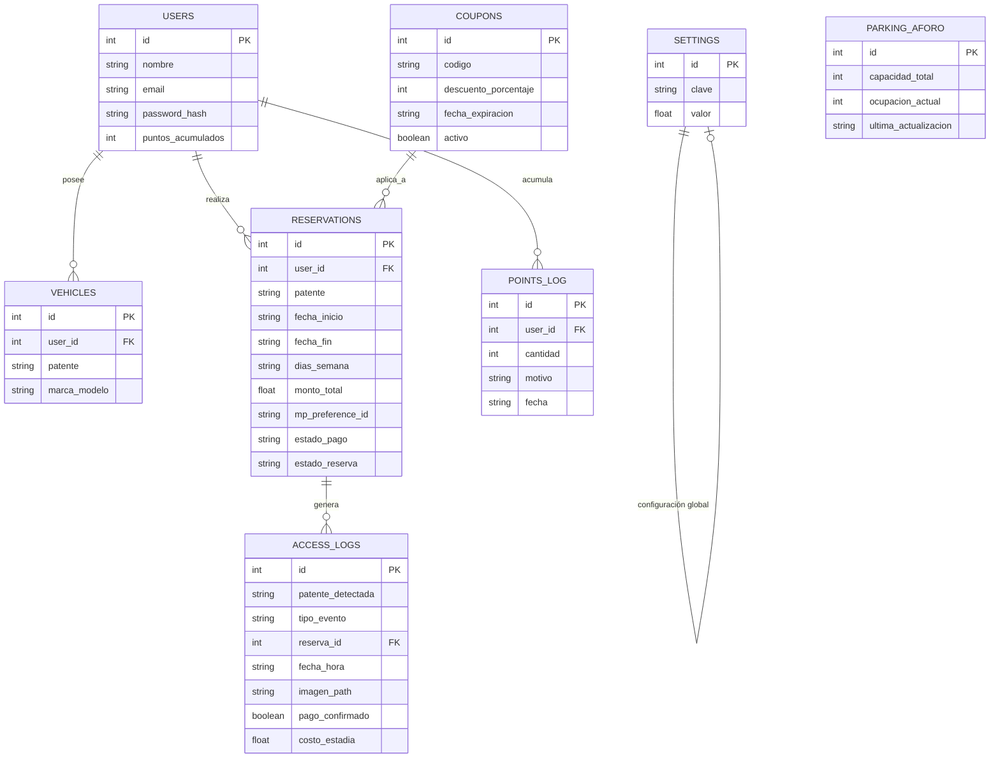
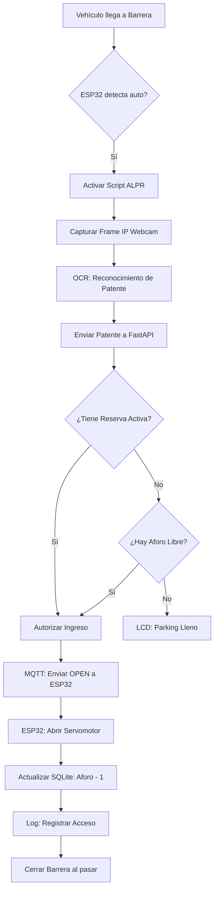

# Esquema de Base de Datos: ParkingTech (SQLite)

Este esquema está diseñado para SQLite y optimizado para el control de aforo por flujo y sistema de fidelización.

## Diagrama de Entidad-Relación (DER)

### Explicación de las Relaciones

1. **Usuarios y Vehículos (1:N)**: Un usuario puede registrar múltiples patentes (ej: auto personal, de pareja o de trabajo). Cada vehículo pertenece a un único usuario para vincular la "llave" de acceso al perfil que paga.
2. **Usuarios y Reservas (1:N)**: Un usuario realiza múltiples reservas a lo largo del tiempo. Cada reserva guarda el `user_id` para gestionar el historial y los pagos de Mercado Pago.
3. **Usuarios e Historial de Puntos (1:N)**: Cada transacción de puntos (ganancia o canje) genera un registro vinculado al usuario. El saldo en `users.puntos_acumulados` es la suma de este historial.
4. **Cupones y Reservas (1:N)**: Un mismo código de cupón (ej: 'PROMO10') puede aplicarse a muchas reservas distintas, siempre que esté activo y dentro de su fecha de vigencia.
5. **Reservas y Registros de Acceso (1:N)**: Un registro de acceso ALPR puede estar vinculado a una reserva (si el usuario reservó previamente) o ser nulo (si el usuario entró "al paso"). Un reserva puede tener múltiples accesos (entradas/salidas).
6. **Aforo Global (Independiente)**: La tabla `parking_aforo` funciona como un contador maestro. Es actualizada por el Backend tras cada evento de entrada o salida exitosa detectado por las barreras.
7. **Configuraciones (Independiente)**: La tabla `settings` almacena valores dinámicos como el precio por hora o multas.

---

## Diagrama de Flujo: Proceso de Acceso (ALPR)

---

## Tablas del Sistema

### 1. Usuarios (`users`)
| Campo | Tipo | Descripción |
| :--- | :--- | :--- |
| `id` | INTEGER (PK) | ID único |
| `nombre` | TEXT | Nombre completo |
| `email` | TEXT (Unique) | Correo para login |
| `password_hash` | TEXT | Contraseña encriptada |
| `puntos_acumulados` | INTEGER | Saldo actual de puntos de fidelidad |

### 2. Vehículos (`vehicles`)
| Campo | Tipo | Descripción |
| :--- | :--- | :--- |
| `id` | INTEGER (PK) | ID único |
| `user_id` | INTEGER (FK) | Dueño del vehículo |
| `patente` | TEXT (Unique) | Patente (Clave para ALPR) |
| `marca_modelo` | TEXT | Descripción del auto |

### 3. Reservas y Pagos (`reservations`)
| Campo | Tipo | Descripción |
| :--- | :--- | :--- |
| `id` | INTEGER (PK) | ID de la reserva |
| `user_id` | INTEGER (FK) | Usuario que reserva |
| `patente` | TEXT | Patente autorizada para esta reserva |
| `tipo_vehiculo` | VARCHAR | Tipo de vehículo (`auto`, `moto`, `camioneta` — migración `a4c8d2e3f5b6`) |
| `sucursal_nombre` | VARCHAR | Nombre de la sucursal asignada |
| `sucursal_info` | JSON | Metadata de la sucursal al momento de reservar |
| `fecha_inicio` | DATETIME | Timestamp de inicio (UTC) |
| `fecha_fin` | DATETIME | Timestamp de fin (UTC) |
| `dias_semana` | VARCHAR (Null) | Días permitidos para pases periódicos |
| `monto_total` | FLOAT | Valor cobrado de la reserva |
| `monto_reembolsado` | FLOAT | Monto devuelto en caso de cancelación parcial/total |
| `metodo_pago` | VARCHAR | Método utilizado (`SALDO`, `MERCADOPAGO`, `CAJA`, `DIGITAL` — migración `d3b7e1a9c2f0`) |
| `mp_preference_id` | VARCHAR | ID de preferencia de Mercado Pago |
| `estado_pago` | VARCHAR | Status de pago (`Pendiente`, `Pagado`, `Reembolsado`, `Fallido`) |
| `estado_reserva` | VARCHAR | Status de reserva (`PENDIENTE_PAGO`, `PAGADA`, `EN_USO`, `FINALIZADA`, `CANCELADA`) |
| `cliente_nombre` | VARCHAR | Nombre completo del cliente precargado |
| `created_at` / `updated_at` | DATETIME | Timestamps de auditoría |

### 4. Inventario de Aforo (`parking_aforo`)
| Campo | Tipo | Descripción |
| :--- | :--- | :--- |
| `id` | INTEGER (PK) | ID único |
| `sucursal` | VARCHAR | Nombre de la sucursal |
| `capacidad_total` | INTEGER | Capacidad física total PB |
| `ocupacion_actual` | INTEGER | Ocupación física actual PB |
| `capacidad_motos` / `ocupacion_motos` | INTEGER | Plazas físicas y ocupación para motos |
| `capacidad_camionetas` / `ocupacion_camionetas` | INTEGER | Plazas físicas y ocupación para camionetas |
| `capacidad_reservas_autos/motos/camionetas/reservas` | INTEGER | Cupos exclusivos para reservas (PB) |
| `ocupacion_reservas_autos/motos/camionetas/reservas` | INTEGER | Contadores de cupos ocupados por reservas (PB) |

### 5. Pisos de Estacionamiento (`parking_floors`)
| Campo | Tipo | Descripción |
| :--- | :--- | :--- |
| `id` | INTEGER (PK) | ID del piso |
| `branch_id` | INTEGER (FK) | Sucursal a la que pertenece |
| `nombre` / `numero_piso` | VARCHAR / INT | Nombre del piso (ej: "Piso 1") |
| `capacidad_total` / `ocupacion_actual` | INTEGER | Capacidad física y ocupación por piso |
| `capacidad_motos` / `ocupacion_motos` | INTEGER | Plazas y ocupación motos |
| `capacidad_camionetas` / `ocupacion_camionetas` | INTEGER | Plazas y ocupación camionetas |
| `capacidad_reservas_*` / `ocupacion_reservas_*` | INTEGER | Cupos exclusivos de reserva del piso |

### 6. Registros de Acceso ALPR (`access_logs`)
| Campo | Tipo | Descripción |
| :--- | :--- | :--- |
| `id` | INTEGER (PK) | ID único |
| `patente_detectada` | VARCHAR | Patente leída por la cámara |
| `normalized_patente` | VARCHAR | Patente normalizada para búsquedas eficientes |
| `tipo_evento` | VARCHAR | `ENTRADA` o `SALIDA` |
| `sucursal` | VARCHAR | Nombre de la sucursal |
| `floor_id` | INTEGER (FK, Null) | Piso asignado |
| `reserva_id` | INTEGER (FK, Null) | Vinculado si existe reserva previa |
| `fecha_hora` | DATETIME | Timestamp del evento (UTC) |
| `imagen_path` | VARCHAR | Ruta de la captura capturada |
| `pago_confirmado` | BOOLEAN | Indica si el pago de estadía fue procesado |
| `costo_estadia` | FLOAT | Costo calculado |
| `metodo_pago` | VARCHAR | `DIGITAL`, `CAJA` (efectivo), `MERCADOPAGO` |
| `fecha_pago` | DATETIME | Timestamp de liquidación |
| `ocr_time` | FLOAT | Tiempo de ejecución OCR (ms) |

### 7. Pagos con Mercado Pago (`mercadopago_payments`)
| Campo | Tipo | Descripción |
| :--- | :--- | :--- |
| `id` | INTEGER (PK) | ID autoincremental de la intención |
| `tipo` | VARCHAR | `reserva` o `estadia` |
| `reserva_id` / `access_log_id` | INTEGER (FK) | Entidad abonada |
| `redemption_ticket_id` | INTEGER (FK) | Ticket de descuento aplicado |
| `patente` | VARCHAR | Patente asociada |
| `monto` / `moneda` | FLOAT / VARCHAR | Importe cobrado (ARS) |
| `external_reference` | VARCHAR (Unique) | Código de referencia `AP-{TIPO}-{id}-{uuid8}` |
| `preference_id` / `payment_id` | VARCHAR | Identificadores devueltos por la API MP |
| `estado` / `mp_status` | VARCHAR | `PENDIENTE`, `APROBADO`, `FALLIDO`, `CANCELADO` |

### 8. Sesiones Multi-Dispositivo (`user_sessions`)
| Campo | Tipo | Descripción |
| :--- | :--- | :--- |
| `id` | INTEGER (PK) | ID único de sesión |
| `user_id` | INTEGER (FK) | Usuario asociado |
| `device_id` | VARCHAR | Hash identificador del dispositivo |
| `user_agent` | VARCHAR | User-Agent del navegador |
| `ip_address` | VARCHAR | Dirección IP remota |
| `created_at` / `last_active` | DATETIME | Timestamps de auditoría de sesión |

### 9. Tickets de Soporte y Mensajes (`support_tickets` & `support_ticket_messages`)
| Campo | Tipo | Descripción |
| :--- | :--- | :--- |
| `support_tickets.id` | INTEGER (PK) | ID del ticket |
| `user_id` | INTEGER (FK) | Cliente emisor |
| `sucursal` | VARCHAR | Sucursal de destino |
| `asunto` / `categoria` | VARCHAR | Título y categoría del ticket |
| `estado` | VARCHAR | `ABIERTO`, `EN_PROCESO`, `RESUELTO`, `CERRADO` |
| `support_ticket_messages.id` | INTEGER (PK) | Mensaje dentro del hilo |
| `ticket_id` | INTEGER (FK) | Ticket asociado |
| `sender_type` | VARCHAR | `USER` o `ADMIN` |
| `mensaje` | TEXT | Texto del mensaje |
| `adjunto_url` / `adjunto_nombre` / `adjunto_size` | VARCHAR / INT | Archivos adjuntos (jpg/png/pdf max 1 MB) |

### 10. Canjes y Vouchers (`redemption_tickets`)
| Campo | Tipo | Descripción |
| :--- | :--- | :--- |
| `id` | INTEGER (PK) | ID del ticket de canje |
| `user_id` | INTEGER (FK) | Usuario beneficiario |
| `promotion_id` | INTEGER (FK) | Promoción canjeada |
| `codigo` | VARCHAR (Unique) | Código único de 16 caracteres |
| `qr_data` | VARCHAR | Data para QR `AUTOPASS_REDEMPTION|ID:{codigo}` |
| `tipo_canje` | VARCHAR | `voucher` o `descuento_reserva` |
| `estado` | VARCHAR | `ACTIVO`, `USADO`, `CANCELADO`, `EXPIRADO` |
| `fecha_expiracion` | DATETIME | Fecha límite de validez (30 días) |
