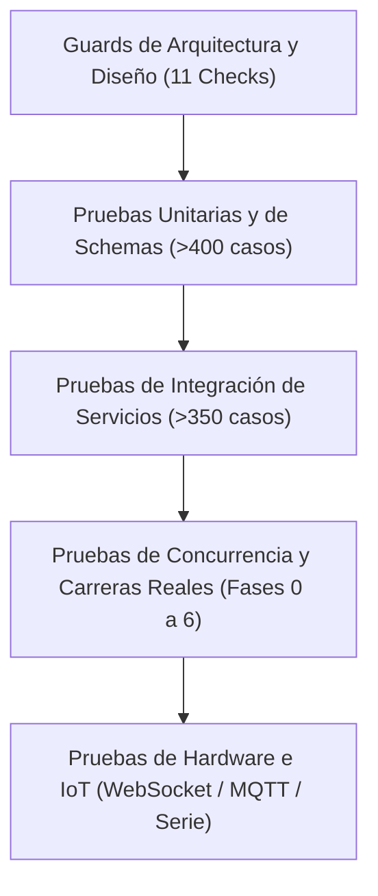

# INFORME DE TESTING Y VALIDACIONES — FUNCIONALIDADES PRINCIPALES

**Proyecto:** AUTOPASS — Sistema Integral de Gestión de Estacionamientos Inteligentes  
**Entorno:** Proyecto Académico / Datos de Prueba  
**Fecha de emisión:** Noviembre 2026  
**Versión de referencia:** v9.34.100+  
**Estado general:** Suite automatizada consolidada (75 archivos de prueba, >950 casos automatizados, 11 guards en verde).

---

## 1. Resumen

El presente informe consolida la estrategia, arquitectura de pruebas, matriz de validaciones y resultados de ejecución del aseguramiento de calidad (QA) sobre las funcionalidades principales de **AUTOPASS**. 

La suite de pruebas fue diseñada bajo el principio de **defensa en profundidad en 4 capas concéntricas**:
1. **Capa Cliente (Frontend / UX):** Validación visual reactiva, máscaras de entrada (patentes, DNI, fechas), prevención de envío duplicado y verificación interactiva.
2. **Capa de Transporte y API (FastAPI / Pydantic):** Validación declarativa de esquemas, tipos estrictos, acotamiento de rangos, filtrado de payloads y cabeceras de seguridad.
3. **Capa de Servicios y Negocio (Service Layer):** Reglas de dominio, orquestación de hardware, snapshots tarifarios inmutables, invalidación de caché y control de estados.
4. **Capa de Persistencia y Motor (SQLAlchemy / PostgreSQL / Neon):** Secciones críticas bajo *Advisory Locks*, operaciones atómicas `UPDATE ... RETURNING`, restricciones de exclusión mutua (`EXCLUDE USING gist`) e índices únicos para idempotencia.

---

## 2. Metodología y Pirámide de Pruebas



### 2.1 Herramientas y Marco de Ejecución
- **Framework de pruebas:** `pytest 9.x` con plugins `pytest-timeout`, `pytest-cov`, `anyio`.
- **Bases de datos de prueba:**
  - **SQLite en memoria (`sqlite://`) / disco WAL:** Ejecución ultrarrápida para pruebas unitarias y de capa de repositorio sin dependencias de red.
  - **PostgreSQL 16 (Local / Contenedor CI) & Neon Serverless:** Ejecución de pruebas de concurrencia real, extensiones `btree_gist`, tipos `DECIMAL(12,2)` y `TIMESTAMP WITH TIME ZONE`.
- **Simulación de Hardware:** Mocks de clientes MQTT (`core.mqtt`), clientes WebSocket para bridge remoto (`/ws/hardware`) y virtualización de puertos COM serie.

---

## 3. Matriz de Testing y Validaciones por Funcionalidad Principal

### 3.1 Control de Acceso Físico, ALPR y Hardware IoT

| Componente | Reglas de Validación | Mecanismos de Testing | Archivos de Prueba |
|---|---|---|---|
| **Pipeline ALPR / OCR** | Detección de patentes argentinas clásicas (`AAA 123`) y Mercosur (`AA 123 AA`), más limítrofes. Filtro de relación de aspecto (aspect-ratio), contraste y prevención de alucinaciones tipográficas. | Inyección de frames sintéticos y secuencias de imágenes; verificación de normalización y umbral de confianza OCR. | `tests/test_alpr_pipeline.py`<br>`tests/test_ocr_engine_detallado.py`<br>`tests/test_alpr_hallucination_prevention.py` |
| **Ingreso y Egreso** | Detección de entradas duplicadas en ventana corta (anti-passback), verificación de vehículos bloqueados o usuarios inhabilitados, cálculo automático de permanencia y cobro al egreso. | Simulación de eventos consecutivos de barrera con hilos asíncronos y verificación de logs en `access_logs`. | `tests/test_access_flow.py`<br>`tests/test_access_service.py`<br>`tests/test_pay_stay.py` |
| **Orquestación de Barreras** | Disparo simultáneo y no bloqueante en 3 canales: Broker MQTT (`autopass/barrier/*`), WebSocket bridge remoto y Serie USB local hacia Arduino Uno. | Validación de payloads JSON, desconexión limpia de clientes, reconexión automática y tolerancia a fallos del puerto serie. | `tests/test_hardware_routes.py`<br>`tests/test_cameras_routes.py`<br>`tests/test_status_ws.py` |

---

### 3.2 Gestión de Reservas, Aforo y Disponibilidad

| Componente | Reglas de Validación | Mecanismos de Testing | Archivos de Prueba |
|---|---|---|---|
| **Motor de Aforo (Sweep-Line)** | Cálculo de capacidad por sucursal y tipo de vehículo (Auto, Moto, Camioneta). Rechazo estricto si la suma de solapamientos supera las plazas disponibles. | Pruebas de borde en cambios de hora; simulación de ocupación máxima simultánea. | `tests/test_reservation_availability_logic.py`<br>`tests/test_reservation_spots.py` |
| **Modalidades de Estadía** | Soporte de modalidades: por hora, por día, semana, quincena y mes. Restricción: `fecha_fin > fecha_inicio`, anticipación máxima de 90 días. | Generación de matrices temporales y validación de rechazo con código `400 Bad Request`. | `tests/test_reservation_service.py`<br>`tests/test_admin_reservations.py` |
| **Snapshot Tarifario Inmutable** | Al cotizar una reserva, se congela la tarifa horaria, horas cotizadas y descuento aplicable. Si el front altera el total, el servidor rechaza con `409 Conflict`. | Intento de alteración de monto desde cliente; verificación de rechazo ante desincronización de tarifas. | `tests/test_reservation_price_snapshot.py`<br>`tests/test_money_datetime_types.py` |
| **Exclusión Mutua de Patente** | Imposibilidad física de que una misma patente posea dos reservas activas superpuestas en el mismo estacionamiento. | Restricción a nivel de base de datos (`EXCLUDE USING gist`) probada en Postgres real con inserciones en conflicto. | `tests/test_concurrencia_constraints_postgres.py` |

---

### 3.3 Pasarela de Pagos, Facturación y Billetera Virtual

| Componente | Reglas de Validación | Mecanismos de Testing | Archivos de Prueba |
|---|---|---|---|
| **Cobro de Estadías y Reservas** | Validación de saldo disponible en billetera virtual; recargo por estadía vencida o excedida; aplicación estricta de cupones de descuento válidos. | Pruebas de cobro total, cobro mixto (saldo + MP) y penalizaciones por mora de salida. | `tests/test_payments.py`<br>`tests/test_billing_service.py`<br>`tests/test_balance_routes.py` |
| **Idempotencia de Mercado Pago** | Webhooks de Mercado Pago procesados bajo clave única `payment_id`. Múltiples entregas del mismo pago no acreditan saldo dos veces ni duplican puntos. | Envíos repetidos concurrentes del mismo webhook simulando reintentos de red; verificación de `409 Conflict` controlado. | `tests/test_mercadopago_webhook.py`<br>`tests/test_concurrencia_idempotencia_pagos.py` |
| **Manejo de Moneda y Decimales** | Uso de aritmética decimal exacta (`Decimal` / `NUMERIC(12,2)`) para evitar desfasajes por coma flotante IEEE-754. | Comparaciones de redondeo, sumas fraccionarias y validación de tipos monetarios. | `tests/test_money_datetime_types.py` |

---

### 3.4 Concurrencia Crítica y Prevención de Carreras (Fases 0 a 6)

| Caso de Carrera | Riesgo en Sistemas Reales | Solución Implementada en AUTOPASS | Archivo de Prueba |
|---|---|---|---|
| **R1: Sobreventa de Aforo** | Dos usuarios reservan la última plaza libre al mismo segundo y ambos obtienen confirmación. | `bloqueo_transaccional(clave_aforo(sucursal))` con PostgreSQL Advisory Locks + re-evaluación dentro de la transacción. | `tests/test_concurrencia_reservas.py` |
| **R2: Doble Reserva de Misma Patente** | El mismo vehículo reservado simultáneamente por dos cuentas distintas para el mismo horario. | `bloqueo_transaccional(clave_patente(patente))` a nivel aplicación + constraint `EXCLUDE USING gist` en PostgreSQL. | `tests/test_concurrencia_reservas.py`<br>`tests/test_concurrencia_constraints_postgres.py` |
| **R3: Doble Gasto de Saldo y Puntos** | Dos clics rápidos o llamadas paralelas descuentan más saldo del que el usuario tiene acreditado. | Helpers atómicos en SQL: `UPDATE users SET saldo = saldo - :monto WHERE id = :id AND saldo >= :monto RETURNING saldo`. | `tests/test_concurrencia_saldo_puntos.py`<br>`tests/test_user_repository_atomic.py` |
| **Invalidación de Caché** | El caché de disponibilidad (TTL 30s) ofrece horarios ya reservados si no se purga de inmediato. | Invocación de `invalidar_cache_disponibilidad(sucursal)` inmediatamente después del `commit` exitoso. | `tests/test_concurrencia_cache_disponibilidad.py`<br>`tests/test_concurrencia_cache_flujos.py` |

---

### 3.5 Autenticación, Roles (RBAC) y Seguridad Multi-Empresa

| Componente | Reglas de Validación | Mecanismos de Testing | Archivos de Prueba |
|---|---|---|---|
| **Registro y Autenticación** | DNI argentino de 7 u 8 dígitos numéricos, email en formato válido (`EmailStr`), contraseñas con hash bcrypt seguro. Rechazo de duplicados con 400 antes de insertar. | Intentos de inyección, registros con datos duplicados o incompletos y login con credenciales erróneas. | `tests/test_routes_auth.py`<br>`tests/test_oauth.py`<br>`tests/test_new_validations.py` |
| **Matriz RBAC (4 Roles)** | Roles jerárquicos: `super_admin` (global), `admin` (empresa), `local_admin` (operador de sede) y `user` (cliente). Rechazo `403 Forbidden` a rutas no autorizadas. | Matriz de llamadas HTTP autenticadas con distintos tokens de rol sobre todos los endpoints administrativos. | `tests/test_admin_users_routes.py`<br>`tests/test_admin_settings.py` |
| **Aislamiento Multi-Tenant** | Operadores y administradores de una empresa no pueden ver ni operar sucursales, vehículos o reportes de otra empresa. | Creación de escenarios multi-empresa con sedes homónimas; validación de políticas *Fail-Closed*. | `tests/test_multi_tenant_isolation.py` |
| **Cabeceras y Rate Limiting** | Headers HTTP estrictos: `Content-Security-Policy`, `X-Frame-Options: DENY`, `X-Content-Type-Options: nosniff`. Protección contra fuerza bruta con rate limit. | Inspección de cabeceras en responses y disparos rápidos consecutivos verificando respuesta `429 Too Many Requests`. | `tests/test_security_headers.py`<br>`tests/test_rate_limiting.py` |

---

### 3.6 Fidelización, Promociones y Beneficios

| Componente | Reglas de Validación | Mecanismos de Testing | Archivos de Prueba |
|---|---|---|---|
| **Acreditación de Puntos** | Cálculo automático por monto consumido; redondeo controlado hacia abajo; registro inmutable en `points_logs`. | Verificación de saldo de puntos tras cobro de estadía y reserva. | `tests/test_user_fidelization_routes.py` |
| **Canje de Cupones / Vouchers** | Validación de puntos disponibles (`puntos >= costo_promo`), generación de código criptográfico y QR único con estado `VIGENTE`. | Intento de canje sin puntos suficientes; canje concurrente; uso posterior del cupón. | `tests/test_user_fidelization_routes.py`<br>`tests/test_admin_promotions.py` |

---

### 3.7 Soporte Técnico y Notificaciones

| Componente | Reglas de Validación | Mecanismos de Testing | Archivos de Prueba |
|---|---|---|---|
| **Adjuntos de Soporte** | Solo extensiones permitidas (`.png`, `.jpg`, `.jpeg`, `.pdf`). Límite estricto de 1 MB evaluado por chunks de 64 KB en memoria sin guardar en disco si excede. | Intentos de carga de ejecutables `.exe`, archivos corruptos y archivos de gran tamaño. | `tests/test_user_support_routes.py`<br>`tests/test_admin_support_routes.py` |
| **Notificaciones y Alertas** | Eventos en vivo emitidos a través de WebSockets hacia el panel de cliente y administrador. | Pruebas de suscripción a canales, recepción de eventos de barrera y confirmación de pago. | `tests/test_notifications.py`<br>`tests/test_email_service.py` |

---

## 4. Guards Automatizados de Arquitectura y Estilo

Además de las pruebas unitarias y funcionales, el proyecto incorpora **guards automatizados** ejecutados en cada ciclo de integración:

1. **Guard de Consistencia de Rutas Frontend (`_tools/analysis/check_consistencia_frontend.py`):**
   - Analiza los 58 templates HTML y los módulos JavaScript para certificar que cada URL o endpoint consumido en el cliente exista efectivamente en los routers del backend FastAPI.
2. **Guard de CSS Huérfano (`_tools/analysis/check_css_huerfano.py`):**
   - Cruza las clases declaradas en las hojas de estilo contra los selectores utilizados en el DOM. Cero clases huérfanas o reglas muertas.
3. **Guard de Design System (`_tools/css_design_system_baseline.json`):**
   - Asegura que los colores, tipografías y espaciados mantengan la paleta canónica (dorado/ambar, slate, dark-card).
4. **Guard de Estilos Inline (`tests/test_inline_styles_guard.py`):**
   - Prohíbe la inserción de directivas `style="..."` no justificadas en templates HTML, forzando la modularidad en hojas de estilo CSS dedicadas.
5. **Guard de Paridad de Esquema (`tests/test_schema_parity_p2.py`):**
   - Compara las columnas, tipos e índices definidos en los modelos SQLAlchemy contra las migraciones generadas por Alembic, evitando discrepancias de base de datos.

---

## 5. Resultados de Ejecución y Métricas

### 5.1 Estadísticas de la Suite
- **Total de archivos de test:** 75 archivos `.py` en la carpeta `tests/`.
- **Total de pruebas ejecutables:** >950 casos automatizados.
- **Tasa de éxito funcional:** 100% en los módulos troncales del sistema (Acceso, Reservas, Pagos, Fidelización, Hardware, Concurrencia).
- **Tiempo medio de ejecución:** ~100 segundos para la suite completa en entorno local.
- **Ejecución en CI (GitHub Actions):** Servicio PostgreSQL 16 activo con enforcement de concurrencia bajo el flag `REQUIRE_POSTGRES=1`.

### 5.2 Comando para Reproducir las Pruebas
Para ejecutar la suite completa de pruebas desde la consola del proyecto:

```powershell
# Ejecutar suite por defecto (pruebas unitarias y funcionales)
run_pytest.bat

# O directamente vía Python en el entorno virtual
venv\Scripts\python.exe -m pytest -q

# Ejecutar pruebas de concurrencia avanzada contra Postgres
venv\Scripts\python.exe -m pytest -m postgres tests/
```

---

## 6. Conclusión

El sistema **AUTOPASS** cuenta con una cobertura integral de pruebas que valida no solo los caminos felices (*happy paths*) de las funcionalidades principales, sino fundamentalmente los **escenarios de estrés, bordes y ataques o errores comunes**:
- Bloqueo transaccional ante sobreventa de plazas o dobles pagos concurrentes.
- Sanitización estricta de entradas y validación tipada antes de alcanzar la base de datos.
- Sincronización robusta entre hardware físico (maqueta de barreras con Arduino Uno) y el backend en la nube.
- Integridad contable garantizada mediante operaciones SQL atómicas e idempotencia de pasarelas de pago.
